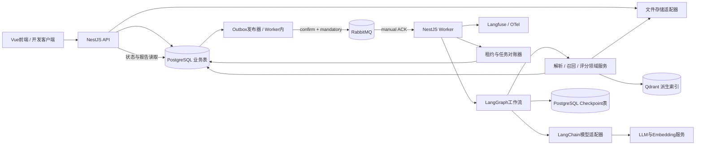
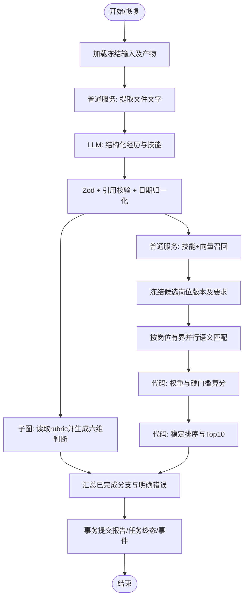
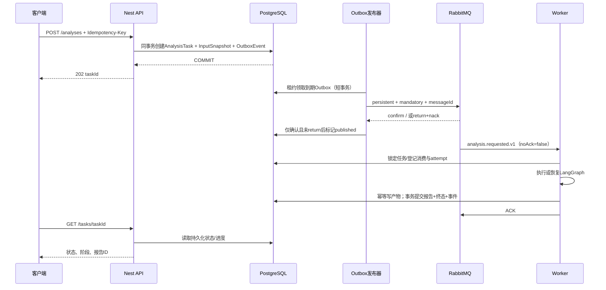
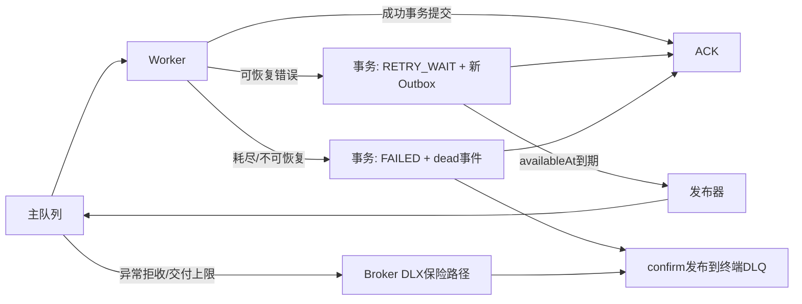
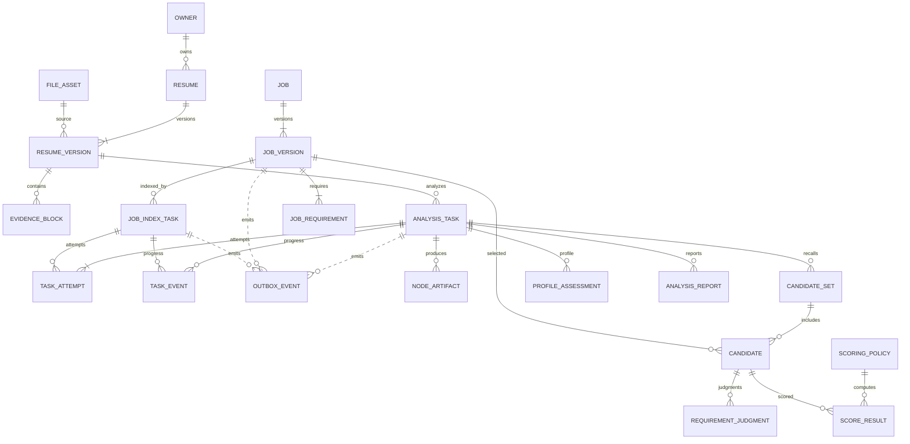

# Resume Studio 技术架构

状态：API/空Worker与基础设施诊断已实现；本文的正式任务、简历分析、工作流和报告部分属于目标设计。当前运行能力与限制见[README](../README.md)和[测试文档](testing.md)。六维Rubric、模型与Embedding选择见[待决策事项](development-roadmap.md#6-待决策事项)；第三方参考见[源码分析](reference-research.md)，版本依据见[兼容性说明](dependency-compatibility.md)。

## 1. 核心概念与取舍

**模块化单体**：代码按业务边界划分，但不用网络调用把每个模块拆开。Resume Studio 使用同一仓库、同一发布版本的两个入口：API 接收请求，Worker 执行耗时任务。它们共享契约和领域模块，不是各自演进的一组微服务。

**工作流与 Agent**：工作流规定已知顺序；Agent 在允许范围内选择行为。简历分析的依赖顺序是已知的，因此 LangGraph 显式组织步骤，只有语义抽取和判断调用 LLM。第一版没有自由规划工具循环，也不需要 Supervisor Agent。以后若出现开放式“继续查缺失证据/多来源研究”，再评估受限子 Agent，不建立自己的运行时。

**至少一次交付与幂等**：RabbitMQ 可能重复发送消息；幂等意味着相同业务操作被调用多次，最终只产生一次有效提交。不能靠 `redelivered` 标志或内存 Set 保证幂等，也不能宣称 LLM 计费一定只发生一次。

**Outbox**：把业务变更和“待发送事件”放入同一数据库事务，再由发布器补发。它消除“事务已提交而消息丢失”的窗口；发布成功但标记失败仍可能重复，所以仍需消费幂等。

**Checkpoint**：工作流状态快照及待完成节点，用于崩溃后继续；不替代任务记录、报告、授权或队列。Prisma 管业务表，官方 PostgresSaver 管自己的表，二者独立事务。

以下任务实体、Outbox、NodeArtifact与Checkpoint均为目标设计；当前Schema只有诊断表。已确定的是组件方向、职责分工与一致性原则；候选并发数、超时、重试和租约参数须通过集成与负载测试确认，Rubric等级、评分映射和权重等业务政策须单独审查，不将这些提案写成已实现或生产级保证。

## 2. 整体架构



前端是独立仓库 [Resume-Studio-Frontend](https://github.com/Mingan-X/Resume-Studio-Frontend)，只通过[接口契约规范](api-contract.md)约定的HTTP与SSE接口访问后端，与API同源部署，不直接访问数据库、队列或模型服务。

本地文件放在受控持久卷，API/Worker挂载同一目录；数据库只记录 storageKey 与哈希。接口用 StoragePort，未来换对象存储而不改工作流。多主机部署前必须切换共享对象存储，不能用各自机器的本地文件。

PostgreSQL 是业务真源；Qdrant 是可重建索引；RabbitMQ 负责交付；Langfuse 负责观测。一个 PostgreSQL 实例可以用不同 schema/数据库与账号隔离业务和 Checkpointer；Langfuse 自托管的数据与账号另隔离，不让 Prisma 迁移接管上游表。

本地开发复用PostgreSQL、RabbitMQ、Qdrant已有兼容镜像，但必须使用Resume Studio独立容器、网络和数据卷，不连接其他项目实例。Compose统一管理本项目三个服务并设置pull_policy: never；数据库/账号、vhost/权限、collection另作逻辑隔离。API/Worker可先本机启动，后按需要纳入Compose。Langfuse cloud或独立可选profile待决定。目标系统的健康检查不只表示进程存在：未来API就绪需数据库可用，Worker就绪需队列/数据库/所需配置可用；当前/health仍仅是liveness，诊断模块单独验证服务。LLM故障不应使查询已有报告的API失效。

## 3. 后端模块和依赖方向

| 模块 | 主要职责 | 公开输入/输出 |
|---|---|---|
| ConfigModule | Zod校验配置、版本、预算、连接超时 | 配置对象；缺必需配置时启动失败 |
| IdentityModule | owner上下文与访问控制；开发单用户适配 | ownerId，资源所有权判断 |
| StorageModule | 原文件存储、哈希、读取、删除 | FileAsset；不向模型暴露任意路径 |
| ResumeModule | 上传、版本、解析记录 | Resume/ResumeVersion，不管理模型编排 |
| DocumentParsingModule | PDF/DOCX文字与来源块提取 | ExtractedDocument、warnings |
| JobModule | JD管理、结构化要求、发布版本与索引任务业务状态 | JobVersion、Requirement、JobIndexTask |
| RubricModule | 六维标准、版本、完整等级读取 | RubricSnapshot |
| RetrievalModule | 技能归一化、岗位索引与融合召回 | CandidateSet与来源，不给最终分 |
| ProfileModule | 六维判断校验、等级映射 | ProfileAssessment |
| MatchingModule | 逐要求语义判断与确定性阈值判断 | RequirementJudgment集合 |
| ScoringModule | 规则版本、归一化、贡献、排序 | ScoreBreakdown、RankedJobs；纯函数内核 |
| ReportModule | 报告快照与查询、重算派生版本 | Report、RecomputedReport |
| TaskModule | 两类任务的身份/幂等、租约、尝试和进度基础设施；业务迁移分别校验 | 带taskType的TaskSnapshot、TaskEvent |
| WorkflowModule | LangGraph节点/边、子图与输入快照 | run/resume(taskContext) |
| MessagingModule | amqplib连接、拓扑、confirm、ACK、重连 | 版本化TaskMessage |
| OutboxModule | 事务事件、发布租约、补发、延迟重试 | OutboxEvent |
| PersistenceModule | Prisma、pg池与事务适配器 | repository/transaction ports |
| ObservabilityModule | 结构化日志、OTel、Langfuse回调与脱敏 | trace上下文和指标 |

API入口组合 Controller、应用服务和领域模块；Worker入口组合消息消费者、Workflow、Outbox、对账器。创建任务与报告落库由应用服务协调，不把事务放在Controller，不在领域层到处取ModuleRef。

依赖方向：入口 → 应用编排 → 领域服务/接口 → 基础设施适配器。领域函数不依赖Controller或Worker；Schema在contracts中复用。第一版单package的两个入口即可，不为了共享类型引入Nx/Turborepo或私有npm包。

## 4. 工作流与结构化数据

### 4.1 简历分析图



这里画像与召回共享已验证简历，不存在互相循环依赖。如果未来要把六维结果作为召回条件，应改图让召回依赖画像，不能在并行执行时偷读尚未完成的结果。

每个可重入节点用规范化的结构化材料计算 `operationKey = hash(taskType, taskId, node, branchKey, inputHash, versionSnapshot)`，先查询已保存的NodeArtifact，命中且版本/Schema校验一致才复用。`inputHash`覆盖节点实际消费的不可变输入与配置；`versionSnapshot`包含componentVersion、schemaVersion及所有影响输出的版本。LLM节点还须包含promptVersion、modelConfigVersion，使用rubric/评分/embedding的节点相应包含这些版本。不得用无分隔的字符串拼接，也不能只按taskId缓存语义结果。

并行岗位分支的`branchKey`至少包含jobVersionId；逐要求或分批处理时再包含requirementId或稳定batchId及其要求集合哈希，避免不同岗位/批次写到相同产物。重试或恢复保持业务任务身份与冻结输入，不把attemptId、fenceToken或恢复thread代次放入语义幂等键；这些执行字段用于写入授权，不能改变同一产物的身份。改变输入、prompt或模型配置时创建新的分析/索引请求或明确的新版本，不悄悄复用旧结果。

文件抽取、LLM判断、匹配结果都使用不可变输入版本；节点提交产物后返回产物ID。业务产物先落库、Checkpoint后写入的崩溃窗口，由重入时读取并校验产物解决。

并行岗位使用LangGraph原生Send/子图，候选初始并发上限3、待实测；按 `jobVersionId` 及必要的requirementId/batchId合并结果，不用数组盲append造成重放重复。Graph reducer按与产物一致的稳定分支身份合并，每个分支返回成功或显式失败对象；可恢复异常先有限重试，达到预算后进入任务重试或允许的部分结果策略。六维画像只能提供辅助上下文，不能用画像等级直接替代岗位逐条要求的证据判断。

### 4.2 另一个工作流：JD入库/索引

JD正文保存为草稿版本 → LLM抽取要求 → Zod/证据校验 → 人工或业务规则确认硬门槛/权重 → 在同一PostgreSQL事务内发布不可变JobVersion、创建JobIndexTask并写OutboxEvent（`job.index.requested.v1`）→ Worker embedding → Qdrant幂等upsert → 提交索引任务终态与该版本的indexStatus=READY。

首版采用独立的JobIndexTask，归属JobVersion及目标embeddingVersion/indexVersion；它与AnalysisTask共享Outbox发布器、消息交付、幂等收据、执行尝试、租约/fencing和对账机制，但不复用分析任务的报告、画像或PARTIAL业务含义。JobIndexTask只负责已确认版本的索引生命周期，JD草稿抽取不伪装成简历分析任务；是否异步化草稿抽取可在JobModule内部实现时明确。Task在下文表示两类任务的基础设施概念，不是要求新增统一业务表或Agent Runtime。

JobIndexTask记录自己的status、error、输入/目标版本、generation、fenceToken与租约。Qdrant写入后提交数据库状态仍有跨系统窗口：重投采用确定性point ID执行幂等upsert，只有持有当前fence的执行能更新对应JobVersion的索引状态；旧版本任务不能把新版本标为READY。普通索引服务无需为复用基础设施强行使用LangGraph或创建Checkpoint。

发布权重不能由模型随意决定。草稿/索引失败岗位不声称已参与向量召回。重复索引的point ID由jobVersionId、chunkId、embeddingVersion确定；先Qdrant成功再标READY，崩溃后重复upsert无害。

### 4.3 普通函数与LLM分工

| 操作 | 实现 | 理由 |
|---|---|---|
| 文件类型检测、提取字符、读写文件 | 普通Node服务 | 没有开放推理需求，不能让模型调用任意文件路径 |
| 章节、项目职责、技能语义结构化 | LLM结构化调用 + Schema | 自由文本表达多样；结果必须可定位 |
| 日期区间、重叠任职月数、数值阈值 | 纯函数 | 可复现，未知日期返回unknown；使用冻结asOfDate处理“至今” |
| 六维等级、语义岗位要求理解 | 受限LLM节点 | 需要语义判断；输入仅授权证据和规则，输出不含综合分 |
| rubric加载、向量检索、融合、去重 | 普通服务 | 检索流程已知；搜索分不等于能力分 |
| 权重计算、硬门槛、排序、Top10 | 纯函数 | 确定性、可审计和边界测试 |
| 重试、取消、幂等、任务状态 | 普通应用代码 | 不能依赖prompt是否遵守 |

### 4.4 数据契约

契约使用Zod定义并推导TypeScript类型；写入JSONB前与从模型/消息读取后都验证。不是把JSON字符串塞给下一个Agent后相信模型照抄。

| 对象 | 必需信息 |
|---|---|
| TaskInputSnapshot | ownerId、resumeVersionId、asOfDate、jobCorpusVersionId、rubricVersion、scoringVersion、promptVersion、modelConfigVersion、embeddingVersion、预算 |
| JobIndexInputSnapshot | ownerId/visibility、jobVersionId、JD内容/要求哈希、embeddingVersion、indexVersion、chunker/componentVersion、schemaVersion、预算；不携带分析报告状态 |
| ExtractedDocument | schemaVersion、fileHash、parserVersion、blocks[{id,text,page?,paragraph?,offsets}]、warnings |
| ParsedResume | schemaVersion、经历/项目/技能/教育、每项sourceRefs、unknown字段；PII与分析字段分开 |
| EvidenceRef | sourceType、sourceVersionId、blockId、start、end、quote；页码/坐标仅在解析器确实提供时存在 |
| ProfileJudgment | dimension、status、level或null、featureIds、evidenceRefs、rubricRefs、reason；无score输入 |
| RequirementJudgment | jobVersionId、requirementId、verdict、evidenceRefs、reason、method、可选confidence；无totalScore |
| MatchResult | requirement judgments、ruleVersion、weightsSnapshot、贡献、coverage、硬门槛结果 |
| GraphState | schemaVersion、taskId、输入/产物ID、候选ID、结果映射、结构化错误；不保存连接/Buffer/可执行对象 |

LLM输出未知requirementId、重复ID、缺必需项、越界offset或不属于该简历的引用均不能进入评分。一次受控修复仍失败则显式失败/unknown，不静默删除失败项。置信度供审计，不任由模型通过confidence给自己调高权重。

Graph只保存必要状态和ID；模型调用前由服务加载授权证据。正常使用taskId作为thread_id，Task记录activeGraphThreadId；不确定旧执行是否停机的恢复例外见§5.3。traceId不同于thread_id，重试可有新trace并关联原taskId。不共享全局latestResumeId。

## 5. RabbitMQ、Outbox与任务一致性

### 5.1 拓扑和消息流转



业务交换机 `resume.tasks`（durable direct），队列 `resume.analysis.v1` 与 `resume.job-index.v1`（durable quorum）；路由键 `analysis.requested.v1` / `job.index.requested.v1`。死信交换机 `resume.dead`，终端队列 `resume.analysis.dead.v1`。名称是方案，尚未创建。

任务调度消息只带schemaVersion、messageId、taskType（analysis/job-index）、taskId、dispatchGeneration、occurredAt、traceparent/tracestate；业务数据从数据库读取，不把简历全文、凭证或任意文件路径放入队列。消费者按taskType读取AnalysisTask或JobIndexTask，核对路由、所有权、输入版本与代次，不能信任消息提供任意数据库对象。上图展示分析任务；索引任务走自己的路由和业务状态，复用相同交付基础设施。

### 5.2 Outbox的准确保证

先数据库提交、再直接publish会丢消息；先publish、再提交会产生不存在的任务。数据库事务中等待publish也不能让两者原子提交。因此**第一版采用Outbox**，不等出现故障再补。

OutboxEvent是通用事务事件，不是AnalysisTask的专属子表。用aggregateType与aggregateId标识产生事件的业务聚合（例如AnalysisTask、JobIndexTask或JobVersion），用eventType/payloadVersion确定消息契约；事件内容必要时引用带taskType的任务身份。简历分析创建事务写分析调度事件，岗位发布事务写索引调度事件；没有任务身份的其他业务事件也可使用同一Outbox机制。事件持久化由相关业务事务完成，不通过分析任务服务中转。聚合类型/ID的合法关系由Schema和事务内查验保障，不能把多态aggregateId误画成只指向AnalysisTask的数据库外键。

发布器按availableAt领取事件，使用短事务与`FOR UPDATE SKIP LOCKED`/租约；释放事务后发送网络消息。所有发布使用confirm channel和persistent消息，`mandatory=true`并监听return；publish返回boolean只代表客户端缓冲区背压，不代表broker接受。return、nack、超时、断连都不能标成功。发布失败有限退避，任务保留可见待投递状态。

confirm成功但published标记前崩溃：事件会再次发布，这是允许的重复。禁止“为防重复先标published”。多发布器通过租约隔离，迟到发布仍可能重复，消费端负责最终幂等。

### 5.3 手动ACK、重复消息与并发

- `noAck=false`；同一接收channel上ACK；初始prefetch=1，与Worker并发预算对应。正常路径在报告+终态提交之后ACK。
- `ConsumerReceipt`唯一键 `(consumerName,messageId)`，只在可靠结束或移交后标DONE。仅收到消息不代表处理完成；RUNNING且租约过期的收据必须允许恢复。
- Task采用条件更新和单调`fenceToken`领取执行租约，记录attemptId/leaseOwner/leaseUntil/heartbeatAt。产物与终态提交检查token和状态，旧Worker不能覆盖新结果。
- 同一taskId的LangGraph执行额外用专用pg连接的session advisory lock串行化；租约过期不等于可以无条件启动第二个graph。锁仍被持有时对账器报警/延后，不抢写同一thread。锁或租约丢失则中止模型调用、关闭本次执行资源；锁在graph和Checkpointer操作收束后释放。
- 重复投递若任务已终态或generation已过期，直接ACK且不执行图；若已有有效执行，只有在记录该消息已由当前执行/持久化恢复机制承接后才能ACK，不能悄悄丢弃。无法确认承接时延后处理。
- 心跳建议每10秒、租约60秒；对账器修复过期RUNNING、未发布任务和无终态Checkpoint。需测试网络分区、旧连接迟到写入和advisory lock释放；应用fence不会自动约束官方Checkpointer的内部SQL，所以“同thread不并发运行”是必须验证的条件。

**不确定旧Worker是否停止时的保守恢复**：只有确认旧graph及其写入已停止（例如进程监督确认旧进程退出）才复用同thread续跑。如果锁连接已断，但无法确认旧执行停止，则事务递增graphGeneration并分配新activeGraphThreadId，在新thread用冻结输入和已提交NodeArtifact重入；旧执行的checkpoint只能写旧thread，业务写入被fence拒绝。不要把旧checkpoint内部表复制到新thread，也不要假设TTL/心跳能拦住迟到写入。该例外会损失尚未提交的图内进度，可能重复模型调用，但保证旧工作流不会污染新恢复状态；仍使用官方StateGraph/PostgresSaver，不实现自有运行时。

上述隔离是待实现并验证的要求，不是现有能力。**官方Checkpointer内部SQL不会自动受到业务Fencing Token约束**：业务条件更新只能保护经过该检查的业务表写入，不能阻止旧saver向原thread写入。必须有真实PostgreSQL/Worker集成测试：暂停旧执行并使租约/锁连接失效，启动新执行后恢复旧执行，验证旧token不能提交NodeArtifact/报告/任务终态；无法确认旧执行停止时新执行使用新thread，旧Checkpoint迟到写入不能改变新activeGraphThreadId及其恢复结果；确认旧执行已结束时才用原thread续跑。另测JobIndexTask旧执行不得更新新版本的indexStatus。仅测试TTL、mock token或正常重启不能替代这些故障场景。

### 5.4 重试、死信与长任务

**业务重试采用数据库延迟Outbox**：失败分类后，在事务中更新Task为RETRY_WAIT、递增dispatchGeneration、写入新的messageId与availableAt；提交后ACK原消息。发布器到期再投递。无需RabbitMQ延迟插件，也不会在TTL队列头部阻塞不同延迟消息。



建议任务总共最多3次执行尝试，退避30秒、120秒并加小幅jitter；节点内仅对短时429/超时/5xx最多重试2次。总模型调用/token/时间预算跨尝试累计，避免“节点重试×任务重试”无限放大。具体数值待样本测试。

不可恢复：不支持文件、损坏文件、版本/Schema错误、无法修复的引用；可恢复：短期模型限流、Qdrant/Rabbit/数据库连接故障。依赖配置缺失应阻止Worker就绪；不能把所有4xx一律当永久失败或一律重试。

失败耗尽时将失败记录与dead Outbox一起提交，再ACK；死信为脱敏元数据，原文保存在受控业务存储。未知任务/无法解码消息写Quarantine记录并可靠发dead事件；数据库不可写时不ACK，暂停消费/关闭channel让broker后续重投，避免立即nack(requeue=true)热循环。

队列DLX是保险路径。RabbitMQ默认dead-letter转发不能一概视为不丢失；quorum队列需配置官方at-least-once dead-lettering所需策略（含reject-publish overflow等），目标DLQdurable并可达，交付上限不使用未知默认值。实现任务系统时用真实broker验证策略，不能只写exchange名就声称可靠。

长分析持有未ACK消息：建议单次执行时间上限10分钟，consumer timeout显式设15分钟并实测。AMQP心跳只保连接，不延长业务ACK时限。更长需求应拆成明确的可恢复阶段消息，不无限提高timeout。取消/进程退出时停接新消息、abort外部调用；无法在退出期限内可靠移交的消息不ACK。

## 6. 数据库、Checkpoint与恢复

### 6.1 实体与约束



图中Outbox的emits及两类任务到通用attempt/event的关系为逻辑归属，不表示一条记录同时外键依赖两个任务。Outbox用aggregateType/aggregateId标识来源；任务基础记录使用taskType/taskId并在事务中核对对应任务。实现时可用各类型可空外键加互斥约束等方式加强数据库完整性，具体映射需在迁移设计时确认，不新增空的公共聚合表。

| 实体 | 核心字段/约束 |
|---|---|
| Owner | 开发固定主体；发布前映射身份系统，所有私有资源owner检查 |
| FileAsset | id、ownerId、storageKey、sha256、mime、size、status；不公开原路径 |
| Resume / ResumeVersion | id、ownerId、version、fileAssetId、parsedArtifactId；unique(resumeId,version) |
| EvidenceBlock | sourceVersionId、blockId、text、page/paragraph/offset、hash；引用稳定且版本隔离 |
| Job / JobVersion | 业务ID、版本、JD正文、结构化字段、发布状态、indexStatus、embeddingVersion、effectiveAt |
| JobRequirement | jobVersionId、stableId、dimension、kind、threshold、sourceRef、priority；一条要求一个ID |
| JobCorpusVersion | 发布岗位快照或清单哈希；可见性规则，避免在分析中混用新旧JD |
| RubricVersion | 六维、等级、feature ID、score映射、文本/内容哈希；发布后不可变 |
| ScoringPolicy | version、dimensionWeights、requirementWeightPolicy、verdictCoefficients、unknownPolicy、hardGatePolicy、rounding |
| AnalysisTask | ownerId、resumeVersionId、inputSnapshot、status、stage、generation、activeGraphThreadId、graphGeneration、fenceToken、lease字段、errorCode、reportId、budgetUsage；unique(ownerId,idempotencyKey)并存requestHash |
| JobIndexTask | ownerId、jobVersionId、embeddingVersion、indexVersion、inputSnapshot、status、generation、fenceToken、lease字段、errorCode、budgetUsage；幂等请求键和requestHash；独立索引业务状态 |
| TaskAttempt | attemptId、taskType、taskId、generation、startedAt/endedAt、traceId、errorClass、token/cost；任务重试不覆盖历史 |
| TaskEvent | taskType、taskId、单调seq、stage、counts、safeMessage、createdAt；unique(taskType,taskId,seq)，进度可补读 |
| ConsumerReceipt | consumerName+messageId唯一、taskType、taskId、generation、状态、processedAt；清理周期长于可能重放窗口 |
| OutboxEvent | eventId、aggregateType、aggregateId、eventType、payloadVersion、payload、availableAt、lease、publishAttempts、publishedAt；通用事务事件、无需AnalysisTask外键；到期未发布索引 |
| NodeArtifact | operationKey唯一、taskType、taskId、node、branchKey、inputHash、componentVersion、schemaVersion、适用的promptVersion/modelConfigVersion等版本快照、validatedOutput、createdAt；写入校验当前fence，见§4.1 |
| CandidateSet / Candidate | taskId、corpusVersion、recallConfig、候选顺序、来源rank、jobVersionId；unique(setId,jobVersionId) |
| ProfileAssessment | taskId、rubricVersion、六维判断与计算结果，引用与缺失状态 |
| RequirementJudgment | taskId、jobVersionId、requirementId、model/promptVersion、verdict、evidenceRefs；业务键唯一 |
| ScoreResult | judgmentSetHash、policyVersion、weightsSnapshot、contributions、coverage、total、eligibility；相同输入唯一 |
| AnalysisReport | taskId、revision、sourceReportId、输入版本/TaskInputSnapshot、CandidateSet、ProfileAssessment、全部计划要求及执行状态（已完成项关联RequirementJudgment，未完成项保留状态与原因）、rubricVersion、scoringPolicyVersion、ScoreResult及权重快照、candidateCoverage、warnings；finalize唯一操作键；这些是快照内容要求，不限定判断与执行状态的物理表结构 |
| Quarantine | messageId、消息哈希、错误码、脱敏元数据；非法消息不直接当作正常Task |

普通可检索字段建列，灵活模型产物放JSONB并附schemaVersion；禁止把所有对象只放无Schema的JSON。状态迁移和唯一约束同时由代码/数据库约束保护。人民币/美元费用使用Decimal或最小货币单位，不能用浮点误差当精确账单。

### 6.2 分工与状态机

AnalysisTask状态：`QUEUED → RUNNING → SUCCEEDED / PARTIAL / FAILED / CANCELLED`；暂时失败走`RUNNING → RETRY_WAIT → RUNNING`。JobIndexTask具有独立的`QUEUED/RUNNING/RETRY_WAIT/SUCCEEDED/FAILED/CANCELLED`生命周期，不套用画像/报告的PARTIAL语义；JobVersion.indexStatus仅反映对应目标版本是否可供索引查询。两类任务共享租约、交付和重试原语，状态迁移由各自业务校验。

cancelRequested为独立标志，运行中的取消在安全边界处理；终态不可被迟到Worker改回RUNNING。恢复/重试保持原taskType/taskId及输入快照；仅确认旧执行及其写入停止后复用原thread，无法确认时按§5.3新建恢复thread并使用fence。新的简历分析/重新召回创建新taskId，不覆盖历史任务或报告；索引的新输入/目标版本创建新JobIndexTask，原版本失败重试仍保留原索引任务身份。

`SUCCEEDED`要求所有必需步骤已完成并保存报告：六维都有合法判断状态，召回完成，所有选入精判的要求都有合法结果。unknown是合法业务判断，不等于系统失败；成功召回零岗位可以生成空推荐成功报告。`PARTIAL`表示解析成功且至少一个报告板块可用，但画像/匹配有执行失败、预算截断或显式降级；页面显示已评估/计划候选数量，不能把部分榜单说成全候选Top10。解析失败或两个结果板块都不可用为`FAILED`；部分产物留存供诊断但不伪装最终成功报告。

数据库保存“用户请求已被接收、执行权、可查询进度、报告、重试计划”。Checkpointer保存“图状态、下一节点、pending writes”。Checkpoint表不由Prisma迁移/修改；首次setup作为受控初始化执行，不让每个请求竞争建表。业务池和saver池分别设置上限，计入PostgreSQL总连接预算。

所引用的官方JS文档说明：`durability: sync`在run结束时等待待写入操作，并不意味着每个节点前都已强制同步提交；首次checkpoint之前崩溃仍可能看不到thread。采用sync作为候选，并通过Task输入快照和幂等产物提供额外保护，不承诺中间步骤绝不丢失。

图恢复规则：检查任务终态 → 获取执行锁/租约并判断旧执行是否已停止。确认停止且有未完成Checkpoint时，使用原thread_id、`invoke(null, config)`续跑；确认停止但无Checkpoint时，从冻结输入启动并复用合法NodeArtifact。无法确认停止则分配新恢复thread，从冻结输入与已提交产物重入，不读取旧thread的迟到Checkpoint作为新状态。graph已结束但任务未终态时按已验证产物幂等finalize，仍校验当前fence。普通JobIndexTask恢复不依赖Checkpoint，以索引任务状态、输入快照及幂等upsert恢复。改变graph/schema版本的部署保留旧版本恢复能力或明确迁移/重新分析，不能拿不兼容新图恢复旧状态。

### 6.3 故障窗口与结果

| 故障位置 | 恢复行为 |
|---|---|
| Task事务提交前 | 回滚，无消息；客户端用相同幂等键重试 |
| Task提交后、publish前 | Outbox扫描补发；API能看到待投递 |
| broker接受后、published标记前 | 重发相同messageId，receipt/Task幂等处理 |
| Worker收到后、首Checkpoint前 | broker重投或对账发恢复消息；从冻结输入重入 |
| LLM返回后、产物提交前 | 可能重复调用/计费；不承诺外部副作用exactly once；预算与trace记录尝试 |
| 产物已提交、Checkpoint未提交 | 重放节点命中operationKey，不重复业务写入 |
| 仅一个并行分支成功 | pending writes/持久产物复用成功分支；失败分支有限重试 |
| 报告提交后、ACK前 | 重投发现Task终态，ACK；不重新生成报告 |
| Checkpoint结束、Task终态缺失 | 对账器幂等finalize；产物不完整则报一致性错误，不凭空标成功 |
| PostgreSQL故障 | 不ACK、不继续写不可恢复内存结果；暂停消费，连接恢复后重入 |
| Qdrant故障 | 默认重试；允许降级时只用显式关键词召回并记录degraded，不能伪造向量分 |
| Langfuse故障 | 业务继续；有界缓冲与本地脱敏日志，记录观测丢失指标；不将任务回滚 |
| 已取消/资源被删除 | 中止后续节点；所有提交检查cancel/fence；清理文件需等活动任务安全结束 |

对账器是任务表的定时修复服务，不是自研Agent Runtime：只查过期租约、未完成状态和待发送事件，产生恢复消息或修正终态；真正执行仍交给LangGraph。

## 7. 召回、RAG与索引一致性

当前确定的方案是 **结构化技能关键词检索 + Dense Vector（稠密向量检索）+ RRF（按排名融合）+ LLM 逐项判断**。前两路负责获取岗位候选，RRF 融合候选排名，LLM 随后对候选岗位的每条要求给出带证据的判断；最终评分与排序仍由普通代码完成。当前方案没有采用 BM25 检索或独立 Reranker 模型，不应称为完整的“BM25 + Dense + Reranker”链路，也不因补充这一说明而提前增加组件。

岗位候选先应用已确认的结构条件（岗位是否有效、用户明确选择的城市等），不能将简历缺失的城市/年限当作硬过滤。关键词路径使用版本化技能字典与PostgreSQL字段/数组查询；中文全文检索不能假定默认英文分词可用，首版技能token匹配足够，后续再测中文分词。

向量路径对去除联系方式的项目职责、技能、目标岗位摘要生成embedding，查询Qdrant岗位要求/摘要chunk。按jobVersionId聚合chunk，关键词与向量各取50，再使用RRF融合、去重，最多20个岗位进入精判。RRF参数、并列jobId排序和召回query都版本化；相似度不能直接用作综合分。

以上召回数量与并发是待实测的初始参数。单次AnalysisTask默认最多完成400条唯一的jobVersionId/requirementId判断，恢复/重试不重置这份预算；超过时保存截断原因、计划/已完成/未完成数量，报告PARTIAL且明确排名覆盖范围，不将未执行要求伪装成unknown判断或完整结果。模型重试另累计调用、token、费用和执行期限。具体业务范围与文件/OCR约束见[需求](requirements.md)。

岗位发布事务创建JobIndexTask与通用OutboxEvent，索引状态由该任务管理；Qdrant记录jobVersionId、owner/visibility、corpus/indexVersion、embeddingVersion、内容hash。召回结果必须回查PostgreSQL有效版本，并冻结CandidateSet。分析指定的corpus快照对应索引尚未READY时，等待/报INDEX_NOT_READY或经策略显式关键词降级，不能悄悄混入新版本。历史报告复用冻结候选；新召回使用新AnalysisTask。

embedding模型变化时不能在同collection混入不同维数：新建versioned collection，回填验证后切换alias；旧任务继续使用其版本。rubric和job向量分collection；rubric六维等级由版本化主存储精确取齐，检索用于补充例子，不能随机漏掉低/高等级标准。

## 8. 评分引擎设计

以下为**待确认的评分政策**，全部普通TS纯函数，不含模型调用。输入包括冻结判断、岗位要求和ScoringPolicy；输出总分、每项贡献、覆盖率、eligible/pending/ineligible、警告和规则版本。

### 8.1 画像

每维选择有证据支持的L1–L5或unknown。候选MVP采用版本化的固定等级映射，例如20/40/60/80/100，避免模型自报命中特征个数导致插值被操纵；这些数值仅为待批准初值。缺乏证据返回score=null；六维不强求计算“人的综合能力分”。若未来需要区间插值，再基于真实rubric feature ID编写可测试公式。

六个维度各自的L1–L5行为标准、证据门槛和评分映射尚未定稿；上述映射仍是示例，需在相关阶段确认并版本化后才能作为评分依据。

### 8.2 岗位匹配

逐项匹配必须依据该岗位要求与简历原始证据独立给出met/partial/unmet/unknown；六维画像只是辅助上下文，不能仅凭画像等级推导某条要求是否满足。

对岗位j的有效要求集合R，要求i属于维度d(i)。输入权重必须是有限非负数，拒绝缺失的必需项、重复维度/要求ID、负数、NaN、Infinity及不支持的维度。维度权重W_d≥0、要求相对权重P_i≥0，已启用维度的W总和必须大于0，参与计算的每维P总和也必须大于0；单项0表示不贡献分数，不免除该要求的判断或硬门槛校验。缺失/非法权重在岗位政策发布与调权重算时均拒绝，不静默回退。先在每维内部归一化，避免某一维写更多要求就隐式占更大权重：

对已启用维度：`a_i = (W_d / Σ有要求且权重大于0的维度W) × (P_i / Σ同维要求P)`。维度W为0时该维的a_i直接取0，不求可能为0的维内分母；已启用维度的P总和为0则拒绝输入。

`c(met)=1，c(partial)=0.5，c(unmet)=0，c(unknown)=0`；系数在ScoringPolicy中版本化。

`score = 100 × Σ(a_i × c_i)`；`coverage = Σ已知判断a_i`；`upperBound = min(100, score + 100 × Σunknown a_i)`。

每条contribution=a_i×c_i×100，最终显示四舍五入到两位；排序使用固定精度值与稳定jobVersionId，并明确精度策略。权重以受限整数基点/有理数计算，避免平台locale与任意浮点round顺序产生漂移。没有有效要求时score=null、不可推荐；零总权重属于非法输入，应拒绝评分并记录错误，不能除零、默认补权重或给100。

例：同一维三条要求P=2/1/1，判断met/partial/unknown，则score=62.5，coverage=75%，upperBound=87.5；第三条仍显示“证据不足”，不是“不满足”。修改权重重算只读此判断集合；任何新模型分析是新评估版本。

硬门槛单独处理：确定性证据明确不满足 → ineligible；未知 → pending；全部明确满足且软要求可计分 → eligible。只有eligible进入默认Top10；pending另列待核实，不用0分伪装资格判断。没有足够eligible岗位就少于10条，并说明原因。

报告保留所有精判候选的判断与分数，不能只保存Top10，否则调权无法让第11名进入榜单。重算的范围仍是原CandidateSet，若要找新岗位必须重新召回。至少测试权重归一化、未知覆盖率、硬门槛、空要求、负权重/NaN拒绝、重复ID、同分排序和重算无模型调用。

## 9. API调用链、进度与错误

下表路径均位于 `/api/v1` 之下（例如 `POST /api/v1/analyses`）；地址、错误码、幂等、分页、轮询与SSE的通用约定见[接口契约规范](api-contract.md)。

| 入口（拟定） | 调用链与返回 |
|---|---|
| POST /resumes | UploadController → 类型/大小校验 → Storage → ResumeService → 文件/版本记录；失败清理暂存，孤儿文件定期回收 |
| POST /jobs | JobController → 保存JD草稿与版本 → 结构化/确认；发布事务创建JobIndexTask+OutboxEvent后再调度索引，届时返回对应jobVersionId与索引taskId；草稿创建不等于索引已开始 |
| POST /analyses | 校验owner/输入状态/幂等键 → 冻结配置 → AnalysisTask+OutboxEvent事务 → 202 + taskId/statusUrl |
| GET /tasks/:id | owner校验 → Task+TaskEvent查询 → 状态、stage、完成数/总数、重试时间、safeError、reportId |
| GET /tasks/:id/events | 后续SSE，读持久事件seq；Last-Event-ID补读，断线不取消任务 |
| GET /reports/:id | owner校验 → 不可变报告及引用；不实时重算LLM |
| POST /reports/:id/recompute | 校验新权重 → 冻结原判断全集 → 代码算分/排名 → 新报告revision；原报告不覆盖 |
| POST /tasks/:id/cancel | 写cancelRequested；Worker节点边界检查、停止后续调用并提交取消终态 |

同owner的Idempotency-Key第一次与requestHash绑定；同key同请求返回原taskId，不同请求返回409。幂等键只防同一请求重放，不把用户明确“重新分析”永远折叠为旧报告。

进度先轮询，显示QUEUED/RUNNING、stage和matchedJobs/totalCandidates等真实计数，不伪造等速百分比。若显示百分比，分配固定阶段权重，未知总量先显示阶段，报告提交前不显示100%。重试展示当前attempt和已复用产物，不让旧Worker事件覆盖新代次。SSE只是TaskEvent的传输方式，不靠内存EventEmitter跨API/Worker。

统一错误结构 `{code,message,retryable,requestId,taskId?,details?}`，错误码表见[接口契约规范](api-contract.md#6-错误响应)；同步接口按400/401/403/404/409/413/422/503等HTTP语义返回，任务执行错误通过Task状态返回。日志保留内部堆栈但脱敏，API不透传SQL、密钥、内部路径或第三方完整错误体。

## 10. 可观测性、隐私与部署门槛

API生成request trace，W3C traceparent经Outbox/Rabbit传播；每次attempt关联taskId，图节点、检索、工具和模型各有span。LangChain调用挂Langfuse CallbackHandler；普通解析/算分用OTel手工span，不能只追模型而看不到普通代码耗时。

记录模型提供商、模型标识、prompt/schema版本、延迟、token、retry、工具名、节点状态、引用ID和候选数。费用在有可信价格/供应商usage时计算并标估计；没有usage不能填0冒充免费。UI只展示安全阶段，不输出模型隐藏推理链；可审计解释来自模型显式结果和证据。

默认不把原始简历、姓名、邮箱、电话、完整模型输入放入Langfuse；对模型输入去除与匹配无关的PII，trace保留ID/计数/脱敏摘要。需要调试原文时只能使用合成fixture或有授权受控模式。模型与Langfuse的部署区域、保留时间和出网范围在部署方案确认后配置。

文件、业务产物、Checkpoint、向量和trace有共同保留/删除策略；删除先禁止新任务并取消活动任务，再清理引用和存储，不能只删Resume行留下Checkpoint正文。建议开发合成数据、真实数据默认保留30天作为待确认政策。

关注指标：Outbox最老未发布年龄、队列ready/unacked、任务耗时/失败/重试、租约超时、DLQ数量、LLM错误与token预算、Qdrant索引积压、数据库池饱和、trace丢失。数据库/队列不可用能恢复任务；Langfuse不可用不能阻塞业务。

部署前验证备份和恢复；单节点Compose用于本地开发，不能宣称RabbitMQ quorum单节点或本机PostgreSQL具备节点故障高可用。当前已启动本项目独立容器并验证重启持久化，尚未进行生产部署或备份恢复验收。

## 11. 目录规划

```text
Resume-Studio-Backend/
  AGENTS.md
  README.md
  docs/
    deployment.md
    api.md
    api-contract.md
    testing.md
    requirements.md
    architecture.md
    reference-research.md
    dependency-compatibility.md
    development-roadmap.md
    progress.md
    decisions/0001-tech-stack.md
    research/dependency-metadata-2026-11-23.json
  CONTRIBUTING.md
  src/                         # 已建立最小入口、配置、日志、HTTP与健康检查
    main-api.ts
    main-worker.ts
    app-api.module.ts
    app-worker.module.ts
    contracts/
    modules/                   # 业务模块，见§3
    workflows/                 # 业务图、节点与子图
    infrastructure/            # Prisma/AMQP/Qdrant/Storage/Telemetry
  prisma/                      # 当前仅合成诊断表schema/迁移；业务表尚未实现
  test/                        # 已有配置、HTTP和进程测试；其余按阶段补齐
  infra/                       # Compose和服务初始化配置
  scripts/                     # 初始化、评测、索引维护
  data/                        # 后续运行数据；必须gitignore
```

前端不在本仓库，见 Resume-Studio-Frontend；workflows尚未创建。当前已建立prisma、infra、scripts与临时data目录，生成的凭证/客户端/测试manifest不入Git。官方机制依据统一列在[兼容性文档来源](dependency-compatibility.md#5-官方来源)，本架构中的业务数量、超时、表和协议名称仍是项目提案。
