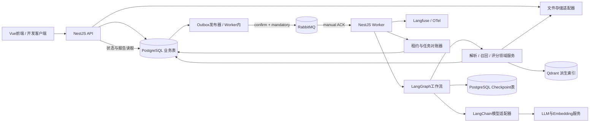
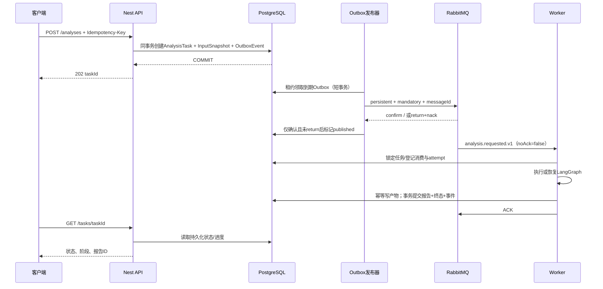
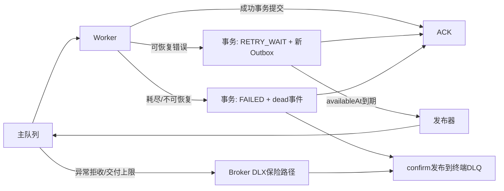
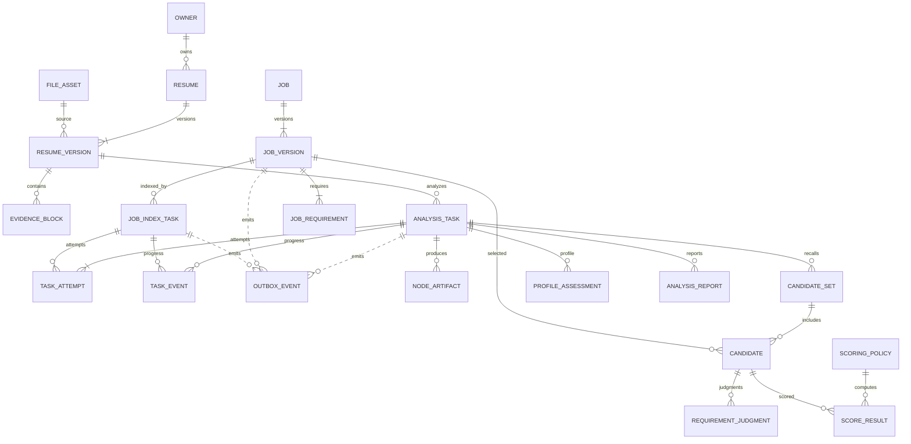

# Resume Studio 技术架构

状态：API/空Worker、基础设施诊断、独立Checkpointer、合成图恢复、本地观测、S1.4合成任务创建/发布/消费、重试/隔离区、对账及T7合成图Checkpoint/fence联合隔离已实现；真实任务执行、简历分析、业务工作流和报告部分属于目标设计。当前运行能力与限制见[README](../README.md)和[测试文档](testing.md)。六维Rubric、模型与Embedding选择见[待决策事项](development-roadmap.md#6-待决策事项)；第三方参考见[源码分析](reference-research.md)，版本依据见[兼容性说明](dependency-compatibility.md)。

## 1. 核心概念与取舍

**模块化单体**：代码按业务边界划分，但不用网络调用把每个模块拆开。Resume Studio 使用同一仓库、同一发布版本的两个入口：API 接收请求，Worker 执行耗时任务。它们共享契约和领域模块，不是各自演进的一组微服务。

**工作流与 Agent**：工作流规定已知顺序；Agent 在允许范围内选择行为。简历分析的依赖顺序是已知的，因此 LangGraph 显式组织步骤，只有语义抽取和判断调用 LLM。第一版没有自由规划工具循环，也不需要 Supervisor Agent。以后若出现开放式“继续查缺失证据/多来源研究”，再评估受限子 Agent，不建立自己的运行时。

**至少一次交付与幂等**：RabbitMQ 可能重复发送消息；幂等意味着相同业务操作被调用多次，最终只产生一次有效提交。不能靠 `redelivered` 标志或内存 Set 保证幂等，也不能宣称 LLM 计费一定只发生一次。

**Outbox**：把业务变更和“待发送事件”放入同一数据库事务，再由发布器补发。它消除“事务已提交而消息丢失”的窗口；发布成功但标记失败仍可能重复，所以仍需消费幂等。

**Checkpoint**：工作流状态快照及待完成节点，用于崩溃后继续；不替代任务记录、报告、授权或队列。Prisma 管业务表，官方 PostgresSaver 管自己的表，二者独立事务。

当前Prisma Schema已有诊断表、Owner、两类任务与attempt/event/receipt/outbox/quarantine模型，以及T7合成NodeArtifact和SyntheticIndexTarget；已实现合成任务创建、发布、消费、重试、对账及Checkpoint联合恢复。真实业务处理器仍属目标设计。官方Checkpoint表由独立setup建立，供合成图使用。并发、超时、重试和租约参数尚未经过生产负载验证，Rubric等级、评分映射和权重等业务政策须单独审查。

## 2. 整体架构

下图表示目标业务链路。当前运行边界如下；基础设施适配器存在不等于API/Worker已调用它们。

| 当前入口/模块 | 实际接线 | 验证边界 |
|---|---|---|
| API / 空Worker | main入口先校验配置，再动态导入bootstrap-api或bootstrap-worker；配置失败只调用独立startup-error；API只装配配置、日志和健康检查，Worker仅配置、日志及存活定时器 | 没有业务任务、模型调用或观测导出 |
| TasksModule / IdentityModule | 显式register数据库连接；应用服务取得可信owner，再校验合成输入，通过TaskRepository写任务和Outbox | 默认固定开发主体，可替换身份provider；仅数据库创建/幂等，不含发布器、消费者或任务HTTP接口 |
| OutboxModule | 显式注册身份、数据库与消息发布适配器，`outbox:publish`执行有界批次 | 短事务领取/发布/条件标记；无常驻轮询，消费者由ConsumerModule提供 |
| ConsumerModule | `tasks:consume`按任务类型运行有界手动ACK会话；身份、执行存储和合成处理器通过Nest装配 | TaskAttempt/ConsumerReceipt、租约心跳与fence保护合成完成事件；未接入业务图或常驻调度 |
| ReconciliationModule | `tasks:reconcile once/watch`按owner分页扫描两类任务，事务修复后调用Outbox发布器 | 与消费者共享执行锁标识；只恢复调度或按预算失败，不凭空生成报告/Checkpoint终态 |
| Checkpointer | 独立provision/setup与pg池；`tasks:consume:graph`显式装配CheckpointTaskHandler合成图 | 未知旧执行切换thread；确认实际执行收束或子进程退出才同thread续跑；产物/终态由业务fence保护，尚无真实简历图 |
| ObservabilityModule | `test/fixtures/observability-graph.ts`使用官方CallbackHandler及手工OTel span；独立集成测试注册Nest模块 | 合成输入与关联/脱敏验证；未验证跨API/Worker传播或真实LLM |
| 本地服务 | 单一resume-studio项目，业务三服务在default网络，Langfuse六服务在observability网络 | 独立账号/卷、双向独立启停；运行结果见开发进度；本机存储性能仍有限制 |

合成恢复图与合成观测图是两套测试，不应将各自通过推断为完整业务图的恢复与观测已联调。



前端是独立仓库 [Resume-Studio-Frontend](https://github.com/Mingan-X/Resume-Studio-Frontend)，只通过[接口契约规范](api-contract.md)约定的HTTP与SSE接口访问后端，与API同源部署，不直接访问数据库、队列或模型服务。

本地文件放在受控持久卷，API/Worker挂载同一目录；数据库只记录 storageKey 与哈希。接口用 StoragePort，未来换对象存储而不改工作流。多主机部署前必须切换共享对象存储，不能用各自机器的本地文件。

PostgreSQL 是业务真源；Qdrant 是可重建索引；RabbitMQ 负责交付；Langfuse 负责观测。一个 PostgreSQL 实例可以用不同 schema/数据库与账号隔离业务和 Checkpointer；Langfuse 自托管的数据与账号另隔离，不让 Prisma 迁移接管上游表。

本地开发复用PostgreSQL、RabbitMQ、Qdrant已有兼容镜像，但必须使用Resume Studio独立容器、网络和数据卷，不连接其他项目实例。基础Compose管理业务三个服务，可选观测配置增加六个Langfuse服务；两份配置同属resume-studio项目，镜像固定digest并设置pull_policy: never。数据库/账号、vhost/权限、collection另作逻辑隔离。API/Worker目前在主机运行。Langfuse使用observability profile、专属网络、账号与卷；业务三服务和观测六服务各自显式启停。目标系统的健康检查不只表示进程存在：未来API就绪需数据库可用，Worker就绪需队列/数据库/所需配置可用；当前/health仍仅是liveness，诊断模块单独验证服务。LLM故障不应使查询已有报告的API失效。

## 3. 后端模块和依赖方向

| 模块 | 主要职责 | 公开输入/输出 |
|---|---|---|
| ConfigModule | Zod校验配置、版本、预算、连接超时 | 配置对象；缺必需配置时启动失败 |
| IdentityModule | owner上下文与访问控制；开发单用户适配 | ownerId，资源所有权判断 |
| StorageModule | 原文件存储、哈希、读取、删除 | FileAsset；不向模型暴露任意路径 |
| ResumeModule | 上传、版本、解析记录 | Resume/ResumeVersion，不管理模型编排 |
| DocumentParsingModule | PDF/DOCX文字与来源块提取 | ExtractedDocument、warnings |
| JobModule | JD管理、结构化要求、发布版本与索引任务业务状态 | JobVersion、Requirement、JobIndexTask |
| RubricModule | 六维标准、版本、完整等级读取 | RubricSnapshot |
| RetrievalModule | 技能归一化、岗位索引与融合召回 | CandidateSet与来源，不给最终分 |
| ProfileModule | 六维判断校验、等级映射 | ProfileAssessment |
| MatchingModule | 逐要求语义判断与确定性阈值判断 | RequirementJudgment集合 |
| ScoringModule | 规则版本、归一化、贡献、排序 | ScoreBreakdown、RankedJobs；纯函数内核 |
| ReportModule | 报告快照与查询、重算派生版本 | Report、RecomputedReport |
| TaskModule | 两类任务的身份/幂等、租约、尝试和进度基础设施；业务迁移分别校验 | 带taskType的TaskSnapshot、TaskEvent |
| WorkflowModule | LangGraph节点/边、子图与输入快照 | run/resume(taskContext) |
| MessagingModule | amqplib连接、拓扑、confirm、ACK、重连 | 版本化TaskMessage |
| OutboxModule | 事务事件、发布租约、补发、延迟重试 | OutboxEvent |
| PersistenceModule | Prisma、pg池与事务适配器 | repository/transaction ports |
| ObservabilityModule | 结构化日志、OTel、Langfuse回调与脱敏 | trace上下文和指标 |

API入口组合 Controller、应用服务和领域模块；Worker入口组合消息消费者、Workflow、Outbox、对账器。创建任务与报告落库由应用服务协调，不把事务放在Controller，不在领域层到处取ModuleRef。

依赖方向：入口 → 应用编排 → 领域服务/接口 → 基础设施适配器。领域函数不依赖Controller或Worker；Schema在contracts中复用。第一版单package的两个入口即可，不为了共享类型引入Nx/Turborepo或私有npm包。

## 4. 工作流与结构化数据

### 4.1 简历分析图


这里画像与召回共享已验证简历，不存在互相循环依赖。如果未来要把六维结果作为召回条件，应改图让召回依赖画像，不能在并行执行时偷读尚未完成的结果。

每个可重入节点用规范化的结构化材料计算 `operationKey = hash(taskType, taskId, node, branchKey, inputHash, versionSnapshot)`，先查询已保存的NodeArtifact，命中且版本/Schema校验一致才复用。`inputHash`覆盖节点实际消费的不可变输入与配置；`versionSnapshot`包含componentVersion、schemaVersion及所有影响输出的版本。LLM节点还须包含promptVersion、modelConfigVersion，使用rubric/评分/embedding的节点相应包含这些版本。不得用无分隔的字符串拼接，也不能只按taskId缓存语义结果。

并行岗位分支的`branchKey`至少包含jobVersionId；逐要求或分批处理时再包含requirementId或稳定batchId及其要求集合哈希，避免不同岗位/批次写到相同产物。重试或恢复保持业务任务身份与冻结输入，不把attemptId、fenceToken或恢复thread代次放入语义幂等键；这些执行字段用于写入授权，不能改变同一产物的身份。改变输入、prompt或模型配置时创建新的分析/索引请求或明确的新版本，不悄悄复用旧结果。

文件抽取、LLM判断、匹配结果都使用不可变输入版本；节点提交产物后返回产物ID。业务产物先落库、Checkpoint后写入的崩溃窗口，由重入时读取并校验产物解决。

并行岗位使用LangGraph原生Send/子图，候选初始并发上限3、待实测；按 `jobVersionId` 及必要的requirementId/batchId合并结果，不用数组盲append造成重放重复。Graph reducer按与产物一致的稳定分支身份合并，每个分支返回成功或显式失败对象；可恢复异常先有限重试，达到预算后进入任务重试或允许的部分结果策略。六维画像只能提供辅助上下文，不能用画像等级直接替代岗位逐条要求的证据判断。

### 4.2 另一个工作流：JD入库/索引

JD正文保存为草稿版本 → LLM抽取要求 → Zod/证据校验 → 人工或业务规则确认硬门槛/权重 → 在同一PostgreSQL事务内发布不可变JobVersion、创建JobIndexTask并写OutboxEvent（`job.index.requested.v1`）→ Worker embedding → Qdrant幂等upsert → 提交索引任务终态与该版本的indexStatus=READY。

首版采用独立的JobIndexTask，归属JobVersion及目标embeddingVersion/indexVersion；它与AnalysisTask共享Outbox发布器、消息交付、幂等收据、执行尝试、租约/fencing和对账机制，但不复用分析任务的报告、画像或PARTIAL业务含义。JobIndexTask只负责已确认版本的索引生命周期，JD草稿抽取不伪装成简历分析任务；是否异步化草稿抽取可在JobModule内部实现时明确。Task在下文表示两类任务的基础设施概念，不是要求新增统一业务表或Agent Runtime。

JobIndexTask记录自己的status、error、输入/目标版本、generation、fenceToken与租约。Qdrant写入后提交数据库状态仍有跨系统窗口：重投采用确定性point ID执行幂等upsert，只有持有当前fence的执行能更新对应JobVersion的索引状态；旧版本任务不能把新版本标为READY。普通索引服务无需为复用基础设施强行使用LangGraph或创建Checkpoint。

发布权重不能由模型随意决定。草稿/索引失败岗位不声称已参与向量召回。重复索引的point ID由jobVersionId、chunkId、embeddingVersion确定；先Qdrant成功再标READY，崩溃后重复upsert无害。

### 4.3 普通函数与LLM分工

| 操作 | 实现 | 理由 |
|---|---|---|
| 文件类型检测、提取字符、读写文件 | 普通Node服务 | 没有开放推理需求，不能让模型调用任意文件路径 |
| 章节、项目职责、技能语义结构化 | LLM结构化调用 + Schema | 自由文本表达多样；结果必须可定位 |
| 日期区间、重叠任职月数、数值阈值 | 纯函数 | 可复现，未知日期返回unknown；使用冻结asOfDate处理“至今” |
| 六维等级、语义岗位要求理解 | 受限LLM节点 | 需要语义判断；输入仅授权证据和规则，输出不含综合分 |
| rubric加载、向量检索、融合、去重 | 普通服务 | 检索流程已知；搜索分不等于能力分 |
| 权重计算、硬门槛、排序、Top10 | 纯函数 | 确定性、可审计和边界测试 |
| 重试、取消、幂等、任务状态 | 普通应用代码 | 不能依赖prompt是否遵守 |

### 4.4 数据契约

契约使用Zod定义并推导TypeScript类型；写入JSONB前与从模型/消息读取后都验证。不是把JSON字符串塞给下一个Agent后相信模型照抄。

| 对象 | 必需信息 |
|---|---|
| TaskInputSnapshot | ownerId、resumeVersionId、asOfDate、jobCorpusVersionId、rubricVersion、scoringVersion、promptVersion、modelConfigVersion、embeddingVersion、预算 |
| JobIndexInputSnapshot | ownerId/visibility、jobVersionId、JD内容/要求哈希、embeddingVersion、indexVersion、chunker/componentVersion、schemaVersion、预算；不携带分析报告状态 |
| ExtractedDocument | schemaVersion、fileHash、parserVersion、blocks[{id,text,page?,paragraph?,offsets}]、warnings |
| ParsedResume | schemaVersion、经历/项目/技能/教育、每项sourceRefs、unknown字段；PII与分析字段分开 |
| EvidenceRef | sourceType、sourceVersionId、blockId、start、end、quote；页码/坐标仅在解析器确实提供时存在 |
| ProfileJudgment | dimension、status、level或null、featureIds、evidenceRefs、rubricRefs、reason；无score输入 |
| RequirementJudgment | jobVersionId、requirementId、verdict、evidenceRefs、reason、method、可选confidence；无totalScore |
| MatchResult | requirement judgments、ruleVersion、weightsSnapshot、贡献、coverage、硬门槛结果 |
| GraphState | schemaVersion、taskId、输入/产物ID、候选ID、结果映射、结构化错误；不保存连接/Buffer/可执行对象 |

LLM输出未知requirementId、重复ID、缺必需项、越界offset或不属于该简历的引用均不能进入评分。一次受控修复仍失败则显式失败/unknown，不静默删除失败项。置信度供审计，不任由模型通过confidence给自己调高权重。

Graph只保存必要状态和ID；模型调用前由服务加载授权证据。正常使用taskId作为thread_id，Task记录activeGraphThreadId；不确定旧执行是否停机的恢复例外见§5.3。traceId不同于thread_id，重试可有新trace并关联原taskId。不共享全局latestResumeId。

## 5. RabbitMQ、Outbox与任务一致性

### 5.1 拓扑和消息流转



T3显式setup建立业务交换机 `resume.tasks`（durable direct），队列 `resume.analysis.v1` 与 `resume.job-index.v1`（durable quorum）；路由键 `analysis.requested.v1` / `job.index.requested.v1`。死信交换机 `resume.dead`，两个终端队列 `resume.analysis.dead.v1`、`resume.job-index.dead.v1`分别按原路由键绑定，覆盖两类任务。主队列使用精确匹配策略：at-least-once dead lettering、reject-publish overflow、delivery-limit=5、consumer-timeout=900000ms；终端队列不回流主队列。拓扑在既有本项目vhost内，账号仅新增这些精确资源权限；测试拓扑采用本轮UUID隔离的s12前缀。

任务调度消息只带schemaVersion、messageId、taskType（analysis/job-index）、taskId、dispatchGeneration、occurredAt、traceparent/tracestate；业务数据从数据库读取，不把简历全文、凭证或任意文件路径放入队列。消费者按taskType读取AnalysisTask或JobIndexTask，核对路由、所有权、输入版本与代次，不能信任消息提供任意数据库对象。上图展示分析任务；索引任务走自己的路由和业务状态，复用相同交付基础设施。

### 5.2 Outbox的准确保证

先数据库提交、再直接publish会丢消息；先publish、再提交会产生不存在的任务。数据库事务中等待publish也不能让两者原子提交。因此**第一版采用Outbox**，不等出现故障再补。

OutboxEvent是通用事务事件，不是AnalysisTask的专属子表。用aggregateType与aggregateId标识产生事件的业务聚合（例如AnalysisTask、JobIndexTask或JobVersion），用eventType/payloadVersion确定消息契约；事件内容必要时引用带taskType的任务身份。简历分析创建事务写分析调度事件，岗位发布事务写索引调度事件；没有任务身份的其他业务事件也可使用同一Outbox机制。事件持久化由相关业务事务完成，不通过分析任务服务中转。聚合类型/ID的合法关系由Schema和事务内查验保障，不能把多态aggregateId误画成只指向AnalysisTask的数据库外键。

发布器按availableAt领取事件，使用短事务与`FOR UPDATE SKIP LOCKED`/租约；释放事务后发送网络消息。所有发布使用confirm channel和persistent消息，`mandatory=true`并监听return；publish返回boolean只代表客户端缓冲区背压，不代表broker接受。return、nack、超时、断连都不能标成功。发布失败有限退避，任务保留可见待投递状态。

confirm成功但published标记前崩溃：事件会再次发布，这是允许的重复。禁止“为防重复先标published”。多发布器通过租约隔离，迟到发布仍可能重复，消费端负责最终幂等。

T3已实现边界：

- 单条CTE以 `FOR UPDATE SKIP LOCKED` 领取到期事件，每次产生新的leaseOwner UUID并递增publishAttempts，租约默认15秒；同事务检查已耗尽的次数/期限。所有操作限定身份适配器提供的ownerId，不在领取事务内等待网络。
- 每次发送使用独立confirm连接/通道和随机correlationId，messageId始终保持Outbox eventId。连接、握手、通道RPC、确认共用5秒截止和socket AbortSignal；return、nack、断连、超时均不写published。publish返回false仍等confirm；旧连接销毁，迟到回调不影响下一次尝试。此做法适合当前低吞吐合成阶段，未宣称连接复用的性能表现。
- 成功标记和失败更新都检查eventId、ownerId、leaseOwner、租约未到期及未终结状态。confirm后数据库写入失败直接暴露错误并保留租约，过期可再领取；真实子进程在该窗口被强杀的T3测试验证重复messageId，并由测试专用ConsumerReceipt事务吸收。T4另实现实际消费路径，见§5.4。
- 默认最多8次发布尝试，自事件createdAt起1小时总期限；1秒起指数退避、上限30秒，抖动为上限的50%–100%。延迟写回availableAt，不在进程中睡眠重试。耗尽或非法事件保存failedAt/lastErrorCode且publishedAt为空，事件和任务仍保留；不自动重置预算，不把基础设施投递失败改成业务任务FAILED。人工恢复入口及告警暂未实现。
- 每个批次最多10条、60秒总期限，到期中止后续发送；单次已开始的数据库操作还受原3秒等待/5秒事务及SQL限制。`outbox:publish`只运行一个批次，未接入后台调度；不创建额外服务。默认身份仅发布固定开发owner的事件。未来服务多owner调度需另定义授权范围。
- 持久化payload经Zod及事件类型/版本/聚合ID一致性检查，支持两类requested.v1及T5 dead.v1（来源为任务或Quarantine）。未知事件终止自动发送并保留错误；新增类型必须明确定义契约和路由，不能任意指定exchange。跨进程trace仍待接入。

RabbitMQ内部死信确认/重试周期独立于客户端发布超时，本机4.4.0配置为180秒；DLX目标暂时无绑定时的留存/恢复测试等待该完整周期，未降低服务端周期或改变5秒发布限制。quorum单节点部署验证不代表多节点高可用。官方行为依据：[publisher confirms](https://www.rabbitmq.com/docs/confirms)、[quorum queues](https://www.rabbitmq.com/docs/quorum-queues)、[amqplib channel API](https://amqp-node.github.io/amqplib/channel_api.html)；本地实测结果见开发进度。

### 5.3 手动ACK、重复消息与并发

- `noAck=false`；同一接收channel上ACK；初始prefetch=1，与Worker并发预算对应。正常路径在报告+终态提交之后ACK。
- `ConsumerReceipt`唯一键 `(consumerName,messageId)`，只在可靠结束或移交后标DONE。仅收到消息不代表处理完成；RUNNING且租约过期的收据必须允许恢复。
- Task采用条件更新和单调`fenceToken`领取执行租约，记录attemptId/leaseOwner/leaseUntil/heartbeatAt。产物与终态提交检查token和状态，旧Worker不能覆盖新结果。
- 同一taskId的LangGraph执行额外用专用pg连接的session advisory lock串行化；租约过期不等于可以无条件启动第二个graph。锁仍被持有时对账器报警/延后，不抢写同一thread。锁或租约丢失则中止模型调用、关闭本次执行资源；锁在graph和Checkpointer操作收束后释放。
- 重复投递若任务已终态或generation已过期，直接ACK且不执行图；若已有有效执行，只有在记录该消息已由当前执行/持久化恢复机制承接后才能ACK，不能悄悄丢弃。无法确认承接时延后处理。
- 心跳建议每10秒、租约60秒；对账器修复过期RUNNING、未发布任务和无终态Checkpoint。需测试网络分区、旧连接迟到写入和advisory lock释放；应用fence不会自动约束官方Checkpointer的内部SQL，所以“同thread不并发运行”是必须验证的条件。

**不确定旧Worker是否停止时的保守恢复**：只有确认旧graph及其写入已停止（例如进程监督确认旧进程退出）才复用同thread续跑。如果锁连接已断，但无法确认旧执行停止，则事务递增graphGeneration并分配新activeGraphThreadId，在新thread用冻结输入和已提交NodeArtifact重入；旧执行的checkpoint只能写旧thread，业务写入被fence拒绝。不要把旧checkpoint内部表复制到新thread，也不要假设TTL/心跳能拦住迟到写入。该例外会损失尚未提交的图内进度，可能重复模型调用，但保证旧工作流不会污染新恢复状态；仍使用官方StateGraph/PostgresSaver，不实现自有运行时。

S1.4-T7已在合成任务上实现并验证上述隔离。**官方Checkpointer内部SQL不会自动受到业务Fencing Token约束**：业务条件更新只能保护经过该检查的业务表写入，不能阻止旧saver向原thread写入。[真实故障测试](../test/integration/checkpoint-fence.test.ts)操作系统级暂停旧子进程、使本轮租约及实际锁连接失效，待新执行完成后恢复旧进程；官方saver实际写入旧thread，新thread状态保持不变，旧token的产物与终态写入被拒绝。另验证确认子进程退出后同thread恢复，以及JobIndexTask对合成新版本目标的保护。真实报告、JobVersion和Qdrant业务索引仍待后续阶段接入。

TaskAttempt.executionStoppedAt只记录可信停止证据：TaskDeliveryHandler等待实际处理器及其资源收束，或本地监督调用方将私有IPC领取身份绑定到自己的子进程并确认exitCode/signalCode。锁失效、租约到期、发送kill或AbortSignal触发都不能单独写此证据。处理器中止后最多观察5秒清理；仍未收束则销毁锁连接、不记录停止，新领取保守切换thread。CheckpointTaskHandler跟踪已开始的saver put/putWrites和业务产物操作，禁止退出后的新写入并等待现有操作及池关闭，避免把graph.invoke返回误当成全部写入结束。这里没有交付常驻进程监督服务。

### 5.4 重试、死信与长任务

#### S1.4-T4 已实现的消费边界

`TaskConsumer`在一个消费会话中使用一条连接、一个任务队列和prefetch=1，消息大小、JSON Schema、contentType、messageId、exchange/routingKey及taskType均验证。owner来自可信IdentityPort，不能由消息指定。数据库按owner/taskType/taskId锁行后核对冻结快照和代次；TaskAttempt、RUNNING收据与单调fenceToken领取在同事务提交，每次以新attemptId作为leaseOwner。receipt的consumerName/messageId重复但task/generation不同会拒绝，不把冲突收据当成去重成功。

终态或旧generation消息写入DONE处置后ACK，不执行处理器；未来generation或未知/越权任务不ACK。有效RUNNING租约返回deferred，关闭本次消费让消息保留，未提前假设可靠承接。过期租约可重新领取，结束旧尝试并记录LEASE_EXPIRED，递增token、保留原taskId/冻结输入，旧执行的心跳、完成及终态写入均须匹配owner、generation、token、attemptId、未过期租约、RUNNING和未取消状态。

心跳更新任务及当前收据采用同一事务、同一个数据库时间。心跳不重叠执行；失败会abort本次处理器，完成前等待已开始的心跳结束，禁止后台继续续租。执行受输入冻结预算、跨尝试首个startedAt推导的总期限及单次上限限制。当前只执行无外部副作用的合成处理器；处理结果与输入哈希核对后，在同事务写SYNTHETIC_COMPLETED TaskEvent、SUCCEEDED、TaskAttempt结束及ConsumerReceipt DONE，再在原channel ACK。合成状态没有报告/indexStatus语义，真实产物事务将随S2接入。

数据库不可读/不可写、SQL提交失败、心跳/租约丢失或停机不ACK，关闭会话且不自动重连形成热循环；T5已为格式错误增加持久隔离后ACK。confirm与消费ACK独立：提交后ACK前进程被强杀时，消息重投到终态任务，不重复产出。数据库trigger保护终态与token/generation单调性；正常操作仍必须经过应用条件更新。T6对账已接入合成执行锁，T7扩展到官方合成图；取消API仍属T8，receipt存在和租约失效都不能证明旧LangGraph已停止。

**业务重试采用数据库延迟Outbox**：失败分类后，在事务中更新Task为RETRY_WAIT、递增dispatchGeneration、写入新的messageId与availableAt；提交后ACK原消息。发布器到期再投递。无需RabbitMQ延迟插件，也不会在TTL队列头部阻塞不同延迟消息。



建议任务总共最多3次执行尝试，退避30秒、120秒并加小幅jitter；节点内仅对短时429/超时/5xx最多重试2次。总模型调用/token/时间预算跨尝试累计，避免“节点重试×任务重试”无限放大。具体数值待样本测试。

不可恢复：不支持文件、损坏文件、版本/Schema错误、无法修复的引用；可恢复：短期模型限流、Qdrant/Rabbit/数据库连接故障。依赖配置缺失应阻止Worker就绪；不能把所有4xx一律当永久失败或一律重试。

失败耗尽时将失败记录与dead Outbox一起提交，再ACK；死信为脱敏元数据，原文保存在受控业务存储。未知任务/无法解码消息写Quarantine记录并可靠发dead事件；数据库不可写时不ACK，暂停消费/关闭channel让broker后续重投，避免立即nack(requeue=true)热循环。

#### S1.4-T5 已实现的失败移交

- 处理器以TaskFailure显式标识UPSTREAM_TIMEOUT/RATE_LIMITED/DEPENDENCY_UNAVAILABLE/UPSTREAM_5XX为可恢复；INPUT_INVALID/UNSUPPORTED_INPUT/OUTPUT_INVALID为永久错误，未知异常归为EXECUTION_FAILED，不解析错误字符串或把任意HTTP 4xx都当永久错误。仅处理器异常/输出校验进入分类；领取、心跳、预算数据库写入、完成/失败事务错误仍暴露为会话失败且不ACK。
- 失败事务锁定当前任务并核验owner/代次/token/attempt/租约。可重试且预算允许时写RETRY_WAIT、retryAt、递增generation，结束attempt、原receipt DONE和TaskEvent，新建messageId及延迟Outbox；所有写入同事务。first retry为24–30秒，后续96–120秒，带20%抖动；由数据库availableAt发布，任务retryAt另阻止提前执行。原taskId与快照不变，旧generation重投直接处置，不再次执行。
- 次数上限取冻结输入，时间总期限由首次attempt.startedAt加maxDurationMs决定，覆盖执行和重试等待。下一次退避无法容纳在总期限内时直接FAILED/DEADLINE_EXCEEDED；次数耗尽为BUDGET_EXHAUSTED。最后一次执行进程中断后，重投也会持久终结，不无限重新领取。总期限到达时仅仍持有当前token且租约恰被该期限截断的执行可以提交失败；不能延长租约或提交成功，接管后的旧token仍被拒绝。
- 每次外部调用前通过budget.reserve原子预留modelCalls/tokens/costMicros（整数微单位），写任务累计usage及本次attempt的token/cost；预留超过剩余预算先拒绝，因此不会先调用再发现超额。失败不退还预留，防止网络结果未知时低估费用；这是保守预算而非精确账单。真实适配器尚未接入，必须申报足够的调用上限并复用此接口，不能用嵌套SDK重试绕过它。elapsedMs记录已结束尝试的执行时间，总deadline另覆盖等待时间。
- 永久错误/预算耗尽写FAILED、attempt结束、receipt DONE、失败事件和dead Outbox后才ACK。dead消息只带事件/原消息ID、任务类型/ID/代次或隔离区ID/哈希、白名单错误码；不携带原文、SQL、原始异常、凭证或任意路径。发布到resume.dead的analysis.dead.v1 / job.index.dead.v1，同一类型终端队列同时保留Broker DLX原requested路由。confirm/mandatory/return及T3有界重发同样适用；失败记录保留不等于已经投递，耗尽发布预算后仍需人工处置，尚无自动恢复/告警入口。
- 无法解码、消息身份/路由不符、未知/不可见任务、未来代次或messageId复用冲突保存Quarantine与dead Outbox后才ACK。Quarantine的ownerId来自消费上下文而不是不可信消息；新增owner/consumerName/dedupeKey复合唯一约束，哈希覆盖正文和信封，不保存原信封/正文。相同非法投递重放/并发只插入一次；没有可用UUID则messageId为空。新服务总是写可信owner，旧诊断无owner记录兼容保留，不开放查询/删除API。
- 重试/失败/隔离事务提交后ACK前强杀进程：重投分别由旧代次、终态、隔离唯一键吸收，不重复增加Outbox或attempt。T5仍只执行合成处理器，不包含定时对账、真实图恢复或外部副作用恰好一次保证。

队列DLX是保险路径。RabbitMQ默认dead-letter转发不能一概视为不丢失；quorum队列需配置官方at-least-once dead-lettering所需策略（含reject-publish overflow等），目标DLQdurable并可达，交付上限不使用未知默认值。实现任务系统时用真实broker验证策略，不能只写exchange名就声称可靠。

长分析持有未ACK消息：建议单次执行时间上限10分钟，consumer timeout显式设15分钟并实测。AMQP心跳只保连接，不延长业务ACK时限。更长需求应拆成明确的可恢复阶段消息，不无限提高timeout。取消/进程退出时停接新消息、abort外部调用；无法在退出期限内可靠移交的消息不ACK。

## 6. 数据库、Checkpoint与恢复

### 6.1 实体与约束



图中Outbox的emits及两类任务到通用attempt/event的关系为逻辑归属，不表示一条记录同时外键依赖两个任务。Outbox用aggregateType/aggregateId标识来源；任务基础记录使用taskType/taskId并在事务中核对对应任务。实现时可用各类型可空外键加互斥约束等方式加强数据库完整性，具体映射需在迁移设计时确认，不新增空的公共聚合表。

| 实体 | 核心字段/约束 |
|---|---|
| Owner | 开发固定主体；发布前映射身份系统，所有私有资源owner检查 |
| FileAsset | id、ownerId、storageKey、sha256、mime、size、status；不公开原路径 |
| Resume / ResumeVersion | id、ownerId、version、fileAssetId、parsedArtifactId；unique(resumeId,version) |
| EvidenceBlock | sourceVersionId、blockId、text、page/paragraph/offset、hash；引用稳定且版本隔离 |
| Job / JobVersion | 业务ID、版本、JD正文、结构化字段、发布状态、indexStatus、embeddingVersion、effectiveAt |
| JobRequirement | jobVersionId、stableId、dimension、kind、threshold、sourceRef、priority；一条要求一个ID |
| JobCorpusVersion | 发布岗位快照或清单哈希；可见性规则，避免在分析中混用新旧JD |
| RubricVersion | 六维、等级、feature ID、score映射、文本/内容哈希；发布后不可变 |
| ScoringPolicy | version、dimensionWeights、requirementWeightPolicy、verdictCoefficients、unknownPolicy、hardGatePolicy、rounding |
| AnalysisTask | ownerId、resumeVersionId、inputSnapshot、status、stage、generation、activeGraphThreadId、graphGeneration、fenceToken、lease字段、errorCode、reportId、budgetUsage；unique(ownerId,idempotencyKey)并存requestHash |
| JobIndexTask | ownerId、jobVersionId、embeddingVersion、indexVersion、inputSnapshot、status、generation、fenceToken、lease字段、errorCode、budgetUsage；幂等请求键和requestHash；独立索引业务状态 |
| TaskAttempt | attemptId、taskType、taskId、generation、startedAt/endedAt、executionStoppedAt、traceId、errorClass、token/cost；结束记账与实际执行停止证据分开，任务重试不覆盖历史 |
| TaskEvent | taskType、taskId、单调seq、stage、counts、safeMessage、createdAt；unique(taskType,taskId,seq)，进度可补读 |
| ConsumerReceipt | consumerName+messageId唯一、taskType、taskId、generation、状态、processedAt；清理周期长于可能重放窗口 |
| OutboxEvent | eventId、aggregateType、aggregateId、eventType、payloadVersion、payload、availableAt、lease、publishAttempts、publishedAt；通用事务事件、无需AnalysisTask外键；到期未发布索引 |
| NodeArtifact | operationKey唯一、taskType、taskId、node、branchKey、inputHash、componentVersion、schemaVersion、适用的promptVersion/modelConfigVersion等版本快照、validatedOutput、createdAt；写入校验当前fence，见§4.1 |
| CandidateSet / Candidate | taskId、corpusVersion、recallConfig、候选顺序、来源rank、jobVersionId；unique(setId,jobVersionId) |
| ProfileAssessment | taskId、rubricVersion、六维判断与计算结果，引用与缺失状态 |
| RequirementJudgment | taskId、jobVersionId、requirementId、model/promptVersion、verdict、evidenceRefs；业务键唯一 |
| ScoreResult | judgmentSetHash、policyVersion、weightsSnapshot、contributions、coverage、total、eligibility；相同输入唯一 |
| AnalysisReport | taskId、revision、sourceReportId、输入版本/TaskInputSnapshot、CandidateSet、ProfileAssessment、全部计划要求及执行状态（已完成项关联RequirementJudgment，未完成项保留状态与原因）、rubricVersion、scoringPolicyVersion、ScoreResult及权重快照、candidateCoverage、warnings；finalize唯一操作键；这些是快照内容要求，不限定判断与执行状态的物理表结构 |
| Quarantine | messageId、消息哈希、错误码、脱敏元数据；非法消息不直接当作正常Task |

普通可检索字段建列，灵活模型产物放JSONB并附schemaVersion；禁止把所有对象只放无Schema的JSON。状态迁移和唯一约束同时由代码/数据库约束保护。人民币/美元费用使用Decimal或最小货币单位，不能用浮点误差当精确账单。

#### S1.4-T1/T2 已实现的映射

- `IdentityModule` 默认提供固定开发owner `00000000-0000-4000-8000-000000000001`，由迁移建立Owner记录；`IDENTITY`/`IdentityPort`可替换，应用服务不接受请求正文的ownerId。未知身份不能自动建立Owner，任务外键拒绝未登记主体。此适配器未接入公网入口，不代表完成登录鉴权。
- 两类任务保持独立表与状态枚举，初始 `QUEUED`、generation=1、fenceToken=0；分析任务初始activeGraphThreadId=taskId、graphGeneration=1。租约、取消、预算使用量等字段只提供存储，领取/心跳/状态迁移由后续任务实现。
- `TaskAttempt`、`TaskEvent`、`ConsumerReceipt`保留taskType/taskId，并以analysisTaskId/jobIndexTaskId互斥外键绑定实际任务；SQL CHECK要求类型、taskId及外键一致，复合外键同时校验ownerId。TaskEvent的seq为正且按taskType/taskId唯一；单调序号的分配逻辑随进度写入实现，本批不提供事件写入服务。TaskAttempt费用用整数微单位与currency保存。
- `OutboxEvent`保留通用aggregateType/aggregateId，无分析任务专属外键；创建服务在同一事务内创建对应聚合并写调度事件。`Quarantine`面向无法可信解析的基础设施消息，messageId可空、不信任owner；本批无面向用户的隔离区查询。其他新增应用查询均显式限定ownerId。
- 合成输入Schema固定 `schemaVersion: 1`、`kind: synthetic`，明确冻结输入版本、预算及配置版本；versionId暂为合成UUID，无尚不存在的ResumeVersion/JobVersion外键。快照内嵌于任务JSONB，因此任务、快照、Outbox是同库同事务。写入及幂等读回都执行Zod校验；SQL核对快照owner/版本与列一致，并用trigger禁止更新输入、版本、owner、幂等键和requestHash。S2接入真实资源时须另加迁移与授权检查，不能直接把合成ID当成业务记录。
- 幂等作用域为 `(ownerId, taskType, Idempotency-Key)`，各任务表唯一 `(ownerId,idempotencyKey)`；key按UUID校验并统一小写。SHA-256覆盖任务类型及完整验证后的快照（含owner、所有版本和预算），递归排序对象键，数组顺序保持；不包含生成的taskId、事件时间。相同请求返回原taskId，差异请求抛出安全的 `IDEMPOTENCY_CONFLICT`，HTTP错误适配器映射409。并发唯一冲突发生后先回滚，再从新事务视图读取已提交赢家；没有内存幂等缓存或无界重试。
- 当前调度payload仅含schemaVersion/messageId/taskType/taskId/dispatchGeneration/occurredAt；不含输入正文、owner凭证或任意trace字段。跨进程trace字段在后续接入时扩展并验证；T3发布器只发送已验证的两类调度消息。

约束与不可变trigger由[迁移SQL](../prisma/migrations/202611250001_s14_task_foundation/migration.sql)维护，Prisma Schema不完整表达CHECK/trigger。官方Checkpoint库/schema不受该迁移管理。

#### S1.4-T7 已实现的产物与线程映射

- [T7迁移](../prisma/migrations/202611260004_s14_checkpoint_fence/migration.sql)新增TaskAttempt.executionStoppedAt、NodeArtifact与合成SyntheticIndexTarget；旧attempt默认无停止证据。SQL trigger要求graphGeneration单调且与activeGraphThreadId一同切换。新领取在同一事务更新租约/fence和图身份；对账仅恢复调度，不提前选择thread。
- NodeArtifact.operationKey为规范化SHA-256，覆盖ownerId、taskType/taskId、node、完整冻结输入哈希、componentVersion和schemaVersion。两类任务互斥复合外键约束owner/task一致；读写均先锁任务并核对当前租约、fence、generation、取消/期限和适用的图身份。命中时校验结构和输入身份，允许新尝试复用已提交的旧fence产物。当前只有顺序合成节点，分支、prompt/model版本扩展仍按§4.1在真实业务接入时补齐。
- SyntheticIndexTarget只表示合成目标的jobVersionId/embeddingVersion/indexVersion及PENDING/READY；发布必须同时匹配当前执行权和全部目标版本。它用于T7真实进程故障断言，不代替S2.2的Job/JobVersion模型，也不产生Qdrant索引。

### 6.2 分工与状态机

AnalysisTask状态：`QUEUED → RUNNING → SUCCEEDED / PARTIAL / FAILED / CANCELLED`；暂时失败走`RUNNING → RETRY_WAIT → RUNNING`。JobIndexTask具有独立的`QUEUED/RUNNING/RETRY_WAIT/SUCCEEDED/FAILED/CANCELLED`生命周期，不套用画像/报告的PARTIAL语义；JobVersion.indexStatus仅反映对应目标版本是否可供索引查询。两类任务共享租约、交付和重试原语，状态迁移由各自业务校验。

cancelRequested为独立标志，运行中的取消在安全边界处理；终态不可被迟到Worker改回RUNNING。恢复/重试保持原taskType/taskId及输入快照；仅确认旧执行及其写入停止后复用原thread，无法确认时按§5.3新建恢复thread并使用fence。新的简历分析/重新召回创建新taskId，不覆盖历史任务或报告；索引的新输入/目标版本创建新JobIndexTask，原版本失败重试仍保留原索引任务身份。

`SUCCEEDED`要求所有必需步骤已完成并保存报告：六维都有合法判断状态，召回完成，所有选入精判的要求都有合法结果。unknown是合法业务判断，不等于系统失败；成功召回零岗位可以生成空推荐成功报告。`PARTIAL`表示解析成功且至少一个报告板块可用，但画像/匹配有执行失败、预算截断或显式降级；页面显示已评估/计划候选数量，不能把部分榜单说成全候选Top10。解析失败或两个结果板块都不可用为`FAILED`；部分产物留存供诊断但不伪装最终成功报告。

数据库保存“用户请求已被接收、执行权、可查询进度、报告、重试计划”。Checkpointer保存“图状态、下一节点、pending writes”。Checkpoint表不由Prisma迁移/修改；S1.3已经使用独立数据库resume_studio_checkpoint和langgraph schema，通过显式命令运行官方setup并分离初始化/运行账号；生产API/Worker尚未接入。首次setup作为受控初始化执行，不让每个请求竞争建表。业务池和saver池分别设置上限，计入PostgreSQL总连接预算。

S1.3合成图使用已固定的LangGraph 1.7.5与 `durability: sync`；该版本pregel/loop实现包含每步等待Checkpoint写入。测试还从数据库实际确认首节点Checkpoint后再强杀进程，避免把IPC通知当成持久化完成。T7将相同官方持久化方式接入任务执行权：无Checkpoint时使用任务冻结输入，有Checkpoint时校验用户状态投影后 `invoke(null)`；合成结果必须与两个已提交NodeArtifact一致，再由消费者持当前fence提交终态。真实业务仍需对应的版本化产物和完成条件；合成用例不证明任意外部副作用恰好一次。

图恢复规则：检查任务终态 → 获取执行锁/租约并判断旧执行是否已停止。确认停止且有未完成Checkpoint时，使用原thread_id、`invoke(null, config)`续跑；确认停止但无Checkpoint时，从冻结输入启动并复用合法NodeArtifact。无法确认停止则分配新恢复thread，从冻结输入与已提交产物重入，不读取旧thread的迟到Checkpoint作为新状态。graph已结束但任务未终态时按已验证产物幂等finalize，仍校验当前fence。普通JobIndexTask恢复不依赖Checkpoint，以索引任务状态、输入快照及幂等upsert恢复。改变graph/schema版本的部署保留旧版本恢复能力或明确迁移/重新分析，不能拿不兼容新图恢复旧状态。

### 6.3 故障窗口与结果

| 故障位置 | 恢复行为 |
|---|---|
| Task事务提交前 | 回滚，无消息；客户端用相同幂等键重试 |
| Task提交后、publish前 | Outbox扫描补发；API能看到待投递 |
| broker接受后、published标记前 | 重发相同messageId，receipt/Task幂等处理 |
| Worker收到后、首Checkpoint前 | broker重投或对账发恢复消息；从冻结输入重入 |
| LLM返回后、产物提交前 | 可能重复调用/计费；不承诺外部副作用exactly once；预算与trace记录尝试 |
| 产物已提交、Checkpoint未提交 | 重放节点命中operationKey，不重复业务写入 |
| 仅一个并行分支成功 | pending writes/持久产物复用成功分支；失败分支有限重试 |
| 报告提交后、ACK前 | 重投发现Task终态，ACK；不重新生成报告 |
| Checkpoint结束、Task终态缺失 | 对账器幂等finalize；产物不完整则报一致性错误，不凭空标成功 |
| PostgreSQL故障 | 不ACK、不继续写不可恢复内存结果；暂停消费，连接恢复后重入 |
| Qdrant故障 | 默认重试；允许降级时只用显式关键词召回并记录degraded，不能伪造向量分 |
| Langfuse故障 | 业务继续；有界缓冲与本地脱敏日志，记录观测丢失指标；不将任务回滚 |
| 已取消/资源被删除 | 中止后续节点；所有提交检查cancel/fence；清理文件需等活动任务安全结束 |

对账器是任务表的定时修复服务，不是自研Agent Runtime：只查过期租约、未完成状态和待发送事件，产生恢复消息或修正终态；真正执行仍交给LangGraph。

#### S1.4-T6 当前实现

- `PostgresExecutionLock`给合成消费者提供session advisory lock：以固定命名空间、ownerId/taskType/taskId的SHA-256前64位作为有符号bigint键，UUID统一小写。对账事务使用同键的pg_try_advisory_xact_lock；消费者先拿session锁再领取任务，对账先拿transaction锁再以FOR UPDATE SKIP LOCKED读任务。锁冲突直接延后，不等待或抢占。哈希碰撞最多造成无关任务延迟，不授予并发执行。
- session连接来自原3连接池并在执行期间保留，事务另借连接；当前每个consumer命令最多执行一个任务。退出时显式解锁，连接错误/未知锁结果销毁该连接；锁连接丢失触发AbortSignal，不ACK。扩展进程内并发前必须重新核算池预算。T7已将锁生命周期接到合成LangGraph及saver收束，线程切换由领取事务完成；业务数据库写入仍由generation/fence约束。
- 默认每轮每类最多10个候选，用UUID游标分页并回绕，跳过锁住或校验失败的任务不会一直挡住后续任务。只查询可信owner下过期RUNNING，以及updatedAt超过120秒、retryAt已到的QUEUED/RETRY_WAIT。每个候选在事务中重新判断终态、取消标志、代次、租约及输入Schema，不用扫描时的旧值直接写入。
- 过期且无执行锁的RUNNING在一个事务内结束旧attempt、累计elapsedMs、将旧代次RUNNING收据标DONE，递增generation/fence/recoveryCount，置QUEUED/RECOVERY_QUEUED并写新messageId Outbox和进度事件。原taskId、快照、调用/token/费用预算和graph thread字段不变；晚到旧消息/旧token分别由旧代次与fence拒绝。两个对账实例竞争同一候选只会安排一次恢复。
- 长期QUEUED/RETRY_WAIT缺调度Outbox，或当前代次事件已confirm且超过120秒仍无执行时，才安排新的恢复代次。当前代次未发布事件继续使用T3发布租约/退避/次数；failedAt事件仅报告delivery-failed，不清零重发预算或换新事件绕过限制。未发布事件扫描包含dead及Quarantine来源，由原发布器处理；活跃发布租约不抢占，过期租约由原领取逻辑恢复。进度汇总包含pending/due/failed及最老事件时间。
- recoveryCount默认最多3次，不因重启清零；已有恢复消息仍待发布时等待原投递，不因次数达到上限提前判失败。再次需要恢复却超限，或输入执行次数/总期限已耗尽，则复用T5事务写FAILED/dead。没有首attempt的任务只受恢复次数约束，不臆造执行起点；已开始的任务保持首次attempt总期限。缺少原投递/收据时dead.originalMessageId为空，不生成伪造的消费收据。
- 定时watch立即执行一轮，完成后间隔10秒再执行，轮次不重叠；每轮60秒期限，后续操作停止，已开始的SQL仍受原连接/语句/事务上限约束。连续3轮数据库/修复错误退出并报告安全错误。每个候选失败保留error汇总，继续同页其他候选；发布错误沿用Outbox持久预算。once/watch都由显式命令启动，不新增Docker服务，不默认为API/空Worker引入依赖。
- T6不读取或修正官方Checkpoint，不通过缺失终态推测业务成功；表中Checkpoint结束后的幂等finalize仍属于未来真实产物/业务图接入。取消请求只跳过并保留状态，不提前实现取消API。

## 7. 召回、RAG与索引一致性

当前确定的方案是 **结构化技能关键词检索 + Dense Vector（稠密向量检索）+ RRF（按排名融合）+ LLM 逐项判断**。前两路负责获取岗位候选，RRF 融合候选排名，LLM 随后对候选岗位的每条要求给出带证据的判断；最终评分与排序仍由普通代码完成。当前方案没有采用 BM25 检索或独立 Reranker 模型，不应称为完整的“BM25 + Dense + Reranker”链路，也不因补充这一说明而提前增加组件。

岗位候选先应用已确认的结构条件（岗位是否有效、用户明确选择的城市等），不能将简历缺失的城市/年限当作硬过滤。关键词路径使用版本化技能字典与PostgreSQL字段/数组查询；中文全文检索不能假定默认英文分词可用，首版技能token匹配足够，后续再测中文分词。

向量路径对去除联系方式的项目职责、技能、目标岗位摘要生成embedding，查询Qdrant岗位要求/摘要chunk。按jobVersionId聚合chunk，关键词与向量各取50，再使用RRF融合、去重，最多20个岗位进入精判。RRF参数、并列jobId排序和召回query都版本化；相似度不能直接用作综合分。

以上召回数量与并发是待实测的初始参数。单次AnalysisTask默认最多完成400条唯一的jobVersionId/requirementId判断，恢复/重试不重置这份预算；超过时保存截断原因、计划/已完成/未完成数量，报告PARTIAL且明确排名覆盖范围，不将未执行要求伪装成unknown判断或完整结果。模型重试另累计调用、token、费用和执行期限。具体业务范围与文件/OCR约束见[需求](requirements.md)。

岗位发布事务创建JobIndexTask与通用OutboxEvent，索引状态由该任务管理；Qdrant记录jobVersionId、owner/visibility、corpus/indexVersion、embeddingVersion、内容hash。召回结果必须回查PostgreSQL有效版本，并冻结CandidateSet。分析指定的corpus快照对应索引尚未READY时，等待/报INDEX_NOT_READY或经策略显式关键词降级，不能悄悄混入新版本。历史报告复用冻结候选；新召回使用新AnalysisTask。

embedding模型变化时不能在同collection混入不同维数：新建versioned collection，回填验证后切换alias；旧任务继续使用其版本。rubric和job向量分collection；rubric六维等级由版本化主存储精确取齐，检索用于补充例子，不能随机漏掉低/高等级标准。

## 8. 评分引擎设计

以下为**待确认的评分政策**，全部普通TS纯函数，不含模型调用。输入包括冻结判断、岗位要求和ScoringPolicy；输出总分、每项贡献、覆盖率、eligible/pending/ineligible、警告和规则版本。

### 8.1 画像

每维选择有证据支持的L1–L5或unknown。候选MVP采用版本化的固定等级映射，例如20/40/60/80/100，避免模型自报命中特征个数导致插值被操纵；这些数值仅为待批准初值。缺乏证据返回score=null；六维不强求计算“人的综合能力分”。若未来需要区间插值，再基于真实rubric feature ID编写可测试公式。

六个维度各自的L1–L5行为标准、证据门槛和评分映射尚未定稿；上述映射仍是示例，需在相关阶段确认并版本化后才能作为评分依据。

### 8.2 岗位匹配

逐项匹配必须依据该岗位要求与简历原始证据独立给出met/partial/unmet/unknown；六维画像只是辅助上下文，不能仅凭画像等级推导某条要求是否满足。

对岗位j的有效要求集合R，要求i属于维度d(i)。输入权重必须是有限非负数，拒绝缺失的必需项、重复维度/要求ID、负数、NaN、Infinity及不支持的维度。维度权重W_d≥0、要求相对权重P_i≥0，已启用维度的W总和必须大于0，参与计算的每维P总和也必须大于0；单项0表示不贡献分数，不免除该要求的判断或硬门槛校验。缺失/非法权重在岗位政策发布与调权重算时均拒绝，不静默回退。先在每维内部归一化，避免某一维写更多要求就隐式占更大权重：

对已启用维度：`a_i = (W_d / Σ有要求且权重大于0的维度W) × (P_i / Σ同维要求P)`。维度W为0时该维的a_i直接取0，不求可能为0的维内分母；已启用维度的P总和为0则拒绝输入。

`c(met)=1，c(partial)=0.5，c(unmet)=0，c(unknown)=0`；系数在ScoringPolicy中版本化。

`score = 100 × Σ(a_i × c_i)`；`coverage = Σ已知判断a_i`；`upperBound = min(100, score + 100 × Σunknown a_i)`。

每条contribution=a_i×c_i×100，最终显示四舍五入到两位；排序使用固定精度值与稳定jobVersionId，并明确精度策略。权重以受限整数基点/有理数计算，避免平台locale与任意浮点round顺序产生漂移。没有有效要求时score=null、不可推荐；零总权重属于非法输入，应拒绝评分并记录错误，不能除零、默认补权重或给100。

例：同一维三条要求P=2/1/1，判断met/partial/unknown，则score=62.5，coverage=75%，upperBound=87.5；第三条仍显示“证据不足”，不是“不满足”。修改权重重算只读此判断集合；任何新模型分析是新评估版本。

硬门槛单独处理：确定性证据明确不满足 → ineligible；未知 → pending；全部明确满足且软要求可计分 → eligible。只有eligible进入默认Top10；pending另列待核实，不用0分伪装资格判断。没有足够eligible岗位就少于10条，并说明原因。

报告保留所有精判候选的判断与分数，不能只保存Top10，否则调权无法让第11名进入榜单。重算的范围仍是原CandidateSet，若要找新岗位必须重新召回。至少测试权重归一化、未知覆盖率、硬门槛、空要求、负权重/NaN拒绝、重复ID、同分排序和重算无模型调用。

## 9. API调用链、进度与错误

下表路径均位于 `/api/v1` 之下（例如 `POST /api/v1/analyses`）；地址、错误码、幂等、分页、轮询与SSE的通用约定见[接口契约规范](api-contract.md)。

| 入口（拟定） | 调用链与返回 |
|---|---|
| POST /resumes | UploadController → 类型/大小校验 → Storage → ResumeService → 文件/版本记录；失败清理暂存，孤儿文件定期回收 |
| POST /jobs | JobController → 保存JD草稿与版本 → 结构化/确认；发布事务创建JobIndexTask+OutboxEvent后再调度索引，届时返回对应jobVersionId与索引taskId；草稿创建不等于索引已开始 |
| POST /analyses | 校验owner/输入状态/幂等键 → 冻结配置 → AnalysisTask+OutboxEvent事务 → 202 + taskId/statusUrl |
| GET /tasks/:id | owner校验 → Task+TaskEvent查询 → 状态、stage、完成数/总数、重试时间、safeError、reportId |
| GET /tasks/:id/events | 后续SSE，读持久事件seq；Last-Event-ID补读，断线不取消任务 |
| GET /reports/:id | owner校验 → 不可变报告及引用；不实时重算LLM |
| POST /reports/:id/recompute | 校验新权重 → 冻结原判断全集 → 代码算分/排名 → 新报告revision；原报告不覆盖 |
| POST /tasks/:id/cancel | 写cancelRequested；Worker节点边界检查、停止后续调用并提交取消终态 |

同owner的Idempotency-Key第一次与requestHash绑定；同key同请求返回原taskId，不同请求返回409。幂等键只防同一请求重放，不把用户明确“重新分析”永远折叠为旧报告。

进度先轮询，显示QUEUED/RUNNING、stage和matchedJobs/totalCandidates等真实计数，不伪造等速百分比。若显示百分比，分配固定阶段权重，未知总量先显示阶段，报告提交前不显示100%。重试展示当前attempt和已复用产物，不让旧Worker事件覆盖新代次。SSE只是TaskEvent的传输方式，不靠内存EventEmitter跨API/Worker。

统一错误结构 `{code,message,retryable,requestId,taskId?,details?}`，错误码表见[接口契约规范](api-contract.md#6-错误响应)；同步接口按400/401/403/404/409/413/422/503等HTTP语义返回，任务执行错误通过Task状态返回。日志保留内部堆栈但脱敏，API不透传SQL、密钥、内部路径或第三方完整错误体。

## 10. 可观测性、隐私与部署门槛

目标业务链路：API生成request trace，W3C traceparent经Outbox/Rabbit传播；每次attempt关联taskId，图节点、检索、工具和模型各有span。LangChain调用挂Langfuse CallbackHandler；普通解析/算分用OTel手工span，不能只追模型而看不到普通代码耗时。当前HTTP requestId仅用于请求日志，尚未实现上述跨进程传播。

当前S1.3只观测合成图：SDK回调及手工span共享trace/correlationId，队列白名单化，输入/输出替换为REDACTED，媒体上传关闭；按需ObservabilityModule未接入API/空Worker业务路径。观测最大容量128（可配置），最多16个span/批、128KiB、单请求在途，单批默认2秒并无重试，排队最多4秒；丢失计数可读取并在flush/关闭时输出。详见部署与测试文档。以下模型观测仍属目标设计。

记录模型提供商、模型标识、prompt/schema版本、延迟、token、retry、工具名、节点状态、引用ID和候选数。费用在有可信价格/供应商usage时计算并标估计；没有usage不能填0冒充免费。UI只展示安全阶段，不输出模型隐藏推理链；可审计解释来自模型显式结果和证据。

默认不把原始简历、姓名、邮箱、电话、完整模型输入放入Langfuse；对模型输入去除与匹配无关的PII，trace保留ID/计数/脱敏摘要。需要调试原文时只能使用合成fixture或有授权受控模式。模型与Langfuse的部署区域、保留时间和出网范围在部署方案确认后配置。

文件、业务产物、Checkpoint、向量和trace有共同保留/删除策略；删除先禁止新任务并取消活动任务，再清理引用和存储，不能只删Resume行留下Checkpoint正文。建议开发合成数据、真实数据默认保留30天作为待确认政策。

关注指标：Outbox最老未发布年龄、队列ready/unacked、任务耗时/失败/重试、租约超时、DLQ数量、LLM错误与token预算、Qdrant索引积压、数据库池饱和、trace丢失。数据库/队列不可用能恢复任务；Langfuse不可用不能阻塞业务。

部署前验证备份和恢复；单节点Compose用于本地开发，不能宣称RabbitMQ quorum单节点或本机PostgreSQL具备节点故障高可用。当前已启动本项目独立容器并验证重启持久化，尚未进行生产部署或备份恢复验收。

## 11. 目录规划

```text
Resume-Studio-Backend/
  AGENTS.md
  README.md
  docs/
    deployment.md
    api.md
    api-contract.md
    testing.md
    requirements.md
    architecture.md
    reference-research.md
    dependency-compatibility.md
    development-roadmap.md
    progress.md
    decisions/0001-tech-stack.md
    research/dependency-metadata-2026-11-23.json
  CONTRIBUTING.md
  src/                         # 已建立最小入口、配置、日志、HTTP与健康检查
    main-api.ts
    main-worker.ts
    bootstrap-api.ts           # 仅API应用装配
    bootstrap-worker.ts        # 仅Worker应用装配
    startup-error.ts           # 无Nest运行依赖的安全启动错误
    app-api.module.ts
    app-worker.module.ts
    contracts/
    modules/                   # 业务模块，见§3
    workflows/                 # 业务图、节点与子图
    infrastructure/            # 已有数据库、消息、向量、HTTP与日志适配器
      checkpoint/              # 已有provision/setup、独立池、配置与归属校验
      observability/           # 已有模块、脱敏、导出器、配置与归属校验
  prisma/                      # 诊断、任务/Outbox/收据/隔离区schema与迁移；简历/岗位业务表未实现
  test/                        # 已有配置、HTTP、进程、恢复和观测测试
    fixtures/                  # 合成观测图；不注册到API/Worker
    integration/               # 真实服务测试与恢复子进程fixture
  infra/
    compose.yaml               # 业务三服务
    compose.observability.yaml # 同项目Langfuse六服务，可选profile
  scripts/                     # 已有初始化、显式启停和Prisma命令包装
  patches/                     # 上游类型声明兼容补丁
  data/                        # 本地运行资料和迁移快照，gitignore
```

前端不在本仓库，见 Resume-Studio-Frontend；workflows尚未创建。当前已建立prisma、infra、scripts与临时data目录，生成的凭证/客户端/测试manifest不入Git。官方机制依据见[兼容性文档来源](dependency-compatibility.md#5-官方来源)及§5.2；各节明确列出的合成任务/发布器已有实现，其余业务数量、超时、表和协议仍属方案。
