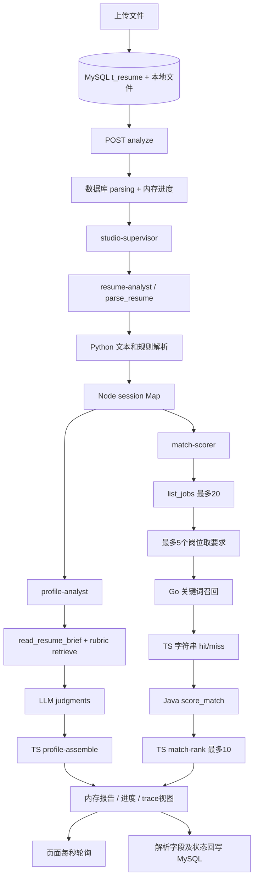

# Elpis / Elpis Demo 源码研究

研究日期：2026-11-23。**这是固定提交的静态源码审查，未安装依赖、未运行数据库、MCP 或真实模型。** “已实现”只表示可定位的实现代码存在，不表示已完成运行验收。

## 1. 研究对象与证据索引

| 标识 | 仓库 | 固定提交 |
|---|---|---|
| E | `https://github.com/fsiaonma/elpis` | `6bc8fe447ce8b05403c31fafed9ef1539f0b6160` |
| D | `https://github.com/fsiaonma/elpis-demo` | `ebc9f034974f8e72031cbbc4b2fa25c8ddfccfdd` |

以下路径均相对于对应参考仓库，不是 Resume Studio 已有代码。GitHub 永久链接构成为 `https://github.com/fsiaonma/elpis-demo/blob/ebc9f034974f8e72031cbbc4b2fa25c8ddfccfdd/<path>#L<line>`；E 仓使用其仓库名与 SHA。

重点核对入口：[实际任务与报告存储](https://github.com/fsiaonma/elpis-demo/blob/ebc9f034974f8e72031cbbc4b2fa25c8ddfccfdd/app/modules/resume/resume.service.ts#L203)、[实际匹配与5岗位限制](https://github.com/fsiaonma/elpis-demo/blob/ebc9f034974f8e72031cbbc4b2fa25c8ddfccfdd/app/modules/resume/session-tools.ts#L117)、[Java评分](https://github.com/fsiaonma/elpis-demo/blob/ebc9f034974f8e72031cbbc4b2fa25c8ddfccfdd/mcp-servers/jd-store-java/src/main/java/com/elpis/jdstore/ScoringEngine.java#L26)、[重算契约](https://github.com/fsiaonma/elpis-demo/blob/ebc9f034974f8e72031cbbc4b2fa25c8ddfccfdd/app/modules/resume/match-recompute.ts#L151)、[Elpis图编译](https://github.com/fsiaonma/elpis/blob/6bc8fe447ce8b05403c31fafed9ef1539f0b6160/app/ai/runtime/langgraph/agent.graph.ts)。

补充关键证据：[会话历史持久化入口](https://github.com/fsiaonma/elpis/blob/6bc8fe447ce8b05403c31fafed9ef1539f0b6160/app/ai/runtime/langgraph/langgraph-orchestrator.service.ts)、[会话存储适配](https://github.com/fsiaonma/elpis/blob/6bc8fe447ce8b05403c31fafed9ef1539f0b6160/app/ai/memory/checkpoint.service.ts)、[进程内session与latestResumeId](https://github.com/fsiaonma/elpis-demo/blob/ebc9f034974f8e72031cbbc4b2fa25c8ddfccfdd/app/modules/resume/analysis-session.ts)、[Go关键词召回](https://github.com/fsiaonma/elpis-demo/blob/ebc9f034974f8e72031cbbc4b2fa25c8ddfccfdd/mcp-servers/recall-go/main.go)、[画像等级映射](https://github.com/fsiaonma/elpis-demo/blob/ebc9f034974f8e72031cbbc4b2fa25c8ddfccfdd/app/skills/profile-assemble.skill.ts)、[排名与证据回退](https://github.com/fsiaonma/elpis-demo/blob/ebc9f034974f8e72031cbbc4b2fa25c8ddfccfdd/app/skills/match-rank.skill.ts)。这些链接固定到本次研究提交，支持静态结论，不构成运行验证。

| 证据 | 文件/关键位置 | 核实内容 |
|---|---|---|
| E1 | `README.md`、`package.json`、`app/ai/` | 框架为 Nest Module 扩展；含 Agent、Tool、MCP、RAG、Store、Trace |
| E2 | `app/ai/runtime/langgraph/agent.graph.ts` | plan → execute → observe 循环，工具批量并行；`graph.compile()` 未传持久 Checkpointer |
| E3 | `app/ai/runtime/langgraph/langgraph-orchestrator.service.ts`、`app/ai/memory/checkpoint.service.ts` | run/streamRun 载入会话，结束时 persistTurn；是会话历史持久化，不是节点级崩溃恢复 |
| E4 | `app/ai/rag/retriever.service.ts`、`app/ai/store/reference/qdrant-vector.store.ts` | 导入、embedding、向量 upsert/query 的真实实现 |
| D1 | `README.md`、`sdd/part4-resume-studio/{spec,plan,tasks}.md` | 产品目标、六维、角色规划、150–300 岗位及 4000→400 判定预算；任务表不等于完成记录 |
| D2 | `app/modules/resume/resume.service.ts:203`、`:299`、`:365`、`:526` | 内存 analyzeRuntime；后台 fire-and-forget 编排；数据库主要持久化解析结果与状态 |
| D3 | `app/agents/*.agent.ts`、`app/prompts/resume-studio-*.prompt.ts` | 四个 Resume Agent 的权限和调用顺序 |
| D4 | `app/modules/resume/session-tools.ts:117`、`:184`、`:351`、`:411` | 字符串 hit/miss、最多 5 次 requirements、list_jobs 限 20、服务端准备评分判断 |
| D5 | `app/modules/resume/analysis-session.ts:12`、`:14`、`:88` | 进程级 Map、latestResumeId 兜底 |
| D6 | `mcp-servers/resume-parser-py/server.py:146`、`:184`、`:446` | pdfplumber/pdf 字符坐标、DOCX 段落、章节/正则提取，只支持 PDF/DOCX |
| D7 | `mcp-servers/recall-go/main.go:4`、`:423`、`skills.dict` | 输入岗位集合上的技能别名/关键词召回，无数据库或向量查询 |
| D8 | `mcp-servers/jd-store-java/src/main/java/com/elpis/jdstore/{JdStoreServer,ScoringEngine}.java` | MySQL 查询与规则加权，权重从 JSON 加载 |
| D9 | `app/skills/profile-assemble.skill.ts:12`、`:106`、`:111` | L1–L5 区间、缺失等级默认 L2、确定性画像算分 |
| D10 | `app/skills/match-rank.skill.ts:169`、`:190`、`:286` | 排名、差距、最多 10 条、证据兜底逻辑 |
| D11 | `app/modules/resume/match-recompute.ts:122`、`:151` | 重算入口到 skill 参数有静态契约不一致 |
| D12 | `app/rag/rubric-level.chunker.ts`、`data/knowledge/rubric/`、`config/config.default.js:55` | 六个 rubric，按级别切片；实际默认 vector driver 是 qdrant |
| D13 | `app/pages/dashboard/resume-studio/report/index.vue:416`、`:442`、`match-panel.vue:215` | 报告 UI、1 秒轮询、权重重算 UI |
| D14 | `app/eval/project-assistant.cases.ts`、`scripts/eval.js` | 已有评测集中于 project-assistant，未发现 Resume 专项 ≥6 条用例 |

## 2. 仓库的实际分层

Elpis：`app/` 下有 HTTP 内核、前端页面和 `ai/` 通用能力；`config/` 为配置；`sdd/` 为分期设计；`docs/ai/` 为能力说明。底层已经使用 LangGraph/LangChain，但又包了一层扫描注册、Planner、Executor、委派上下文和文件 Store。

Demo：`app/modules/resume/` 是业务 HTTP 与编排；`app/agents/` 声明 Agent；`app/prompts/` 约束行为；`app/skills/` 组装确定性结果；`app/rag/` 切分 rubric；`mcp-servers/` 包含 Python/Java/Go；`model/war-room/` 配置页面；`app/pages/dashboard/resume-studio/` 实现报告展示。业务依赖 Elpis 包及其内部桥接加载，本项目不采用这种依赖关系。[E1, D1–D3]

## 3. 实际业务流程

上传服务允许 `.pdf/.docx/.txt`，但解析 MCP 仅实现 PDF/DOCX；TXT 是入口与实际解析能力不一致。解析器本身返回 JSON，写回 MySQL 的是 Node 服务，不应按 spec 描述成 Python MCP 直接入库。[D2, D6]

队长 prompt 指定先解析，再同轮委派画像和匹配。框架支持同轮多个 tool_call 的 Promise.all，所以有并行基础；但执行顺序仍依赖模型遵守 prompt，不能把 prompt 中的“必须”当成图结构保证。[E2, D3]

## 4. Agent、Tool、Skill 与 RAG

| 角色 | 参考项目实际允许能力 | 本项目设计取舍（尚未实现） |
|---|---|---|
| studio-supervisor | 仅 invoke_agent，安排解析→画像/匹配 | 用显式 LangGraph 边替代，无需额外模型决策 |
| resume-analyst | 仅 parse_resume | 文件抽取为普通服务；语义结构化才调用模型 |
| profile-analyst | read_resume_brief、retrieve | 保留有 rubric 与原文证据的结构化画像节点 |
| match-scorer | normalize_skills、list_jobs、get_job_requirements、recall_jobs、score_match、match-rank | 召回/算分/排序用普通代码；真正语义匹配单独建受限 LLM 节点 |
| profile-assemble / match-rank | 普通 TS Skill | 保留纯函数思想，改为领域服务，无需 Skill 运行框架 |

参考 RAG 实际用于 rubric：六个 Markdown 文档，按 overview 与 L1–L5 切片，框架 embedding 后写入 Qdrant，retrieve 供画像分析。配置为 Qdrant，与 Demo README 中“默认文件向量存储”的描述有漂移。画像 prompt 期待每维 L1–L5 全部出现，而配置 topK=3，框架有最低 topK 处理；仅相似度检索也不能保证五个等级齐全。本项目规划按维度和rubricVersion精确加载完整等级，再可选检索例子，尚未实现。[E4, D3, D12]

Go 召回不是 RAG：它没有连 Qdrant，不读 MySQL，而是对 Node 传入的岗位要求做技能字典规范化与匹配。不能将“框架有 Qdrant”推断为“岗位召回已向量化”。[D7]

## 5. 评分机制与实际限制

### 5.1 画像评分

模型给出 dimension、level、hitFeatures、rubricRef、resumeRef；TS 将等级映射为 L1 0–40、L2 41–58、L3 59–72、L4 73–88、L5 89–100，按命中特征比例插值并四舍五入。缺失/非法 level 回退 L2。行为特征分母来自模型回传 rubric 文本，命中数最多 4，但没有严格证明这些特征真实属于 rubric。[D9]

保留“模型判断、代码算分”；替换静默 L2 回退、自由文本特征计数，使用数据库中版本化的 rubric feature ID 与可验证引用。无法判断时 unknown，不自动赋予能力等级。

### 5.2 岗位评分

实际 `judgeRequirement` 使用 threshold 子串、简历第一处“数字+年”、关键词包含等方式生成 hit/miss；当前 match-scorer prompt 明确禁止模型生成 verdicts。因而这不是设计文档描述的 LLM 逐条语义判断。[D3, D4]

Java 规则支持 hit=1、partial=0.5、miss=0；硬要求 miss 可直接 disqualified；否则：

`total = 100 × Σ(该要求所属维度权重 × 判定系数) / Σ(每条要求的维度权重)`。

权重实际来自 `rules/weights.json`（可用 JD_WEIGHTS_PATH 指定），不是岗位数据库权重。Java 查询没有读取每条 requirement 独立权重。按每条要求重复累加维度权重，也意味着“某维要求更多”会增加该维的有效份额。[D8]

TS 排序先按是否淘汰，再按总分降序、jobId 排序，最后 slice(0,10)；并未先剔除淘汰岗位。通常链路最多只读 5 个岗位要求，所以“最多取 10 条”不证明能产出 10 个充分分析过的岗位。[D4, D10]

### 5.3 审计与重算缺口

- `findEvidence` 找不到匹配原文却判断 hit 时，会回退到岗位要求截断文本，不能作为简历证据。[D10:190]
- 重算 UI/API 存在，但 `recomputeMatchWithWeights` 最终把 `{jobs, weights}` 传给要求 `{resumeId}` 的 match-rank；同时包装后的 score_match 重新按 session 组装参数，未把传入自定义权重交给原 Java 调用。静态路径存在契约不一致，不能声称改权重重算已端到端可用。[D4, D11]
- analyzeRuntime/session 为内存 Map，文件 trace 和会话 memory 不等于完整业务报告或节点恢复状态。重启可留下数据库 parsing 状态而丢失后台执行/结果；latestResumeId 兜底还会造成并发上下文混淆风险。[E2–E3, D2, D5]

以上为静态分析结论，不修改参考源码，也未把推断表述成已复现运行故障。

## 6. 实现程度矩阵

下表只评价上述固定提交的参考项目源码，不代表Resume Studio自身的交付状态，也不表示这些代码已经运行验收。

| 功能 | 状态 | 根据与边界 |
|---|---|---|
| 上传/简历列表/删除/解析字段持久化 | 已有实现代码 | D2、Controller；未实跑 |
| PDF/DOCX 文本与规则结构化 | 已有实现代码 | D6；未见 OCR；DOCX 主要段落处理，通用复杂版式质量未验证 |
| 六维 rubric、画像 Agent、雷达/报告 UI | 已有实现代码，质量约束部分实现 | D3/D9/D12/D13；证据完整性、unknown 与数值上限约束不足 |
| 队长串行/并行委派 | 已有实现代码 | E2/D3；由模型调用驱动，无确定性顺序保证 |
| 岗位查询/要求读取 | 已有实现代码 | Java MySQL + 页面只读列表 |
| JD 自动抽取并入库 | 仅设计规划 | D1；parser 仅 parse_resume，Java 工具为读和评分；未见 jd-extractor 实现 |
| 150–300 条 SQL 种子 | 文档目标，未证实数据落地 | 本提交未发现对应 SQL 种子；不推断数据库实际行数 |
| 全库向量召回 | 未在当前链路实现 | Go 为调用方集合上的关键词召回；实际候选限制见 D4 |
| LLM 逐条岗位语义匹配 | 设计与实现不同 | 实际由 TS 简单规则给 hit/miss |
| 确定性综合分与排名 | 已有实现代码 | Java 算分、TS 排序；权重存储、候选范围、淘汰展示有差异 |
| 权重可调且零模型重算 | 部分实现，存在静态接线问题 | D11 与包装器契约不一致 |
| 报告长久保存/任务故障恢复 | 未完整实现 | 解析字段在 MySQL，报告/进度主要在内存；没有 RabbitMQ/Outbox |
| SSE | 框架已有；Resume 页面实际轮询 | E3/D13；不能把后台 streamRun 等同于页面 SSE |
| Resume 专项评测 ≥6 条与发布验收 | 仅任务文档目标 | D14 只有 project-assistant 用例，不将样例 report.json 当此次静态审查测试证据 |

## 7. 保留与替换

以下为业务设计取舍与目标迁移方向，简历分析工作流尚未实现。

保留：六维画像、分级 rubric、原文证据、结构化逐项判断、确定性评分、可解释差距、候选召回后精判、最多 Top 10、分阶段进度、trace 与评测思想。

替换：Elpis 依赖与扫描运行层 → NestJS 模块 + LangGraph；Python/Java/Go MCP → TS 服务；MySQL/Knex → PostgreSQL/Prisma；进程内 Map → 任务与产物表；模型安排固定流程 → 图边；会话历史持久化/进程内状态 → Task、NodeArtifact 与官方 PostgresSaver 节点级 Checkpoint；JSON 默认权重 → 版本化规则；关键词“判定器” → 有引用的 LLM 判断与确定性阈值规则；内存后台任务 → RabbitMQ + Outbox。Task是业务任务概念，首版设计分别为AnalysisTask与JobIndexTask，具体归属见[架构设计](architecture.md#6-数据库checkpoint与恢复)。

不直接复用 rubric 全文或实现代码；此次静态审查研究的是设计与行为，后续如需复制资产必须先核对许可文件与归属。两仓 package.json 声明 ISC，但此次静态审查未将声明等同于已完成所有资产的许可审查。
